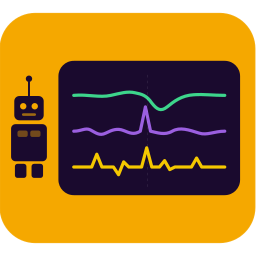

<table>
<tr>
<td width="220" valign="top" align="center">
  <!-- The leading   balances the h1's top margin, so the icon sits midway between the cell's top edge and the title. -->
  
 

  <h1 align="center">wpilog-mcp</h1>
  
Model Context Protocol (MCP) Server for WPILib Logs

</td>
<td valign="middle">

*"Why did the robot die with 30 seconds left?"* *"Why did auto work in practice but not at competition?"* wpilog-mcp gives your AI assistant the tools to analyze your robot's telemetry logs, so you can ask questions like these in plain English and get answers based on the data.

It reads WPILib `.wpilog` files and the REV `.revlog` files recorded beside them. It works with Claude, GitHub Copilot, Gemini, ChatGPT, and any other agent that speaks MCP. Built by [FRC Team 2363 Triple Helix](https://team2363.org).

**Install:** [WPILog Analyzer on the Visual Studio Marketplace](https://marketplace.visualstudio.com/items?itemName=TripleHelixProgramming.wpilog-analyzer), or the [standalone install](doc/STANDALONE.md) for clients outside VS Code

**Documentation:** [Operations and usage manual](doc/OPERATIONS.md) · [VS Code extension](vscode-extension/README.md) · [Standalone install](doc/STANDALONE.md) · [Tools](doc/TOOLS.md) · [Architecture](doc/ARCHITECTURE.md) · [Development](doc/DEVELOPMENT.md) · [all documents](#documentation)

</td>
</tr>
</table>

## How It Works

The [Model Context Protocol](https://modelcontextprotocol.io/) (MCP) is an open standard by which an AI assistant such as Claude calls tools that a server provides; wpilog-mcp is such a server. Its tools open the logs, find entries, compute statistics, and report events. The reasoning is the model's.

A log viewer such as AdvantageScope shows you the data, but only if you know where to look. With wpilog-mcp you ask an engineering or strategy question; the model finds the relevant entries, proposes an explanation, and tests it against the data with further tool calls.

A store organizes logs by robot and session. Continuous folder imports through **Set Up Data Store** are experimental and disabled by default; [enable them on the named server](doc/STANDALONE.md#keeping-a-data-store-up-to-date) to test the setup commands and offer. When enabled, the extension lets you choose the store location and the folders to keep importing. Copy is the default: source logs stay where they are. Move is available for folders you explicitly identify as receiving completed files; duplicate originals are retained. The shared server continues syncing while it runs, even after the editor closes. MCP discovery requires an explicit source when several stores or directories are configured; import preferences do not select a read source. The Explorer source-root migration is a later checkpoint. Nothing is enrolled without approval. [Data store setup](doc/STANDALONE.md#keeping-a-data-store-up-to-date) explains the choices; one-shot import and organizing remain available.

The [recorded visualization preview](doc/VISUALIZATION_PLAN.md) adds **Open Source Overview**, independent layouts, plots, cursor/statistics/raw tables, saved views, reusable templates and source-qualified local or remote MCP editing. Saved views and templates use the server visualization library, independent of log stores; mirrors and ordinary folders need no writable store. Templates use explicit bindings and portable JSON sharing. Open recordings have a paged, searchable inspection overview with fresh selected-signal details. The shared API can check template compatibility across their recording members and persist recording-backed view layouts, resolve a pinned revision and admit its follow. Recording layouts on the selected server preview plots and ordinal raw rows with pause/resume and independent follows. Value and statistics panels use the shared HTTP/MCP reads across recording members, with exact timestamp cursor values, bounded original-sample statistics and explicit independent-prefix evidence. The recording picker accepts explicit numeric struct paths and array indexes after a shared server compatibility check. Histogram and scatter panels use original-sample server analyses for files and recordings, with exact measurement tables, explicit scatter axes and bounded replacement paging. Recording history uses bounded server min/max/mean buckets across every admitted member, preserving early extrema beyond the incremental plot tail. Time-series drag zoom and keyboard pan/zoom save and re-read historical intervals, with an explicit Inspect History state and Resume following. Recorded/live samples and paged inventory share a configurable per-window buffer allowance (64 MiB by default, applied after reload); the broader live feature remains staged. Visible recording views report acquisition health independently of quiet signals and restore their same view after same-owner server session recovery. Normal log opening still uses the existing Explorer editor; the preview is an explicit choice while the staged replacement is reviewed.

### What You Can Ask

Start broad; the model finds the logs and the entries. Then get as specific as the data allows:

- *"Show me our logs from the Chesapeake District event."*
- *"We lost Q42. Look at the log and help us understand what happened."*
- *"What are the scoring rules for this year's game?"*
- *"Pull our match results from The Blue Alliance and look for trends across the event."*
- *"Walk me through the power delivery during teleop in Q42. Were there any brownout concerns?"*
- *"How did our four swerve modules compare in that match? Is one of them lagging the others?"*
- *"Did the vision corrections get larger late in the match? Line up the pose jumps against the time the arm was extended."*
- *"The intake stalled twice. Find every moment its current was above 40 A while its velocity was zero, and show me the CAN bus health around each one."*
- *"Using the REV log, align the SPARK MAX currents with the battery voltage and tell me whether the climber or the drivetrain pulled the voltage down."*

> **Note:** How far the analysis goes depends on two things: the model, and what the model can see beyond the log. wpilog-mcp supplies the tools and the data; the reasoning is the model's, and a more capable model reasons more carefully.
>
> A log records names and numbers, not what they mean. With your robot project open, the model can read the code that writes each entry and learn which mechanism it belongs to, what its units are, and whether it records a measurement or a command. Match results from The Blue Alliance and the season's game rules add still more.

### An Example

**Prompt:** *"We just finished Q68 and the drivers said the robot 'stuttered' during teleop. Investigate the log and tell the pit crew exactly what to check."*

Claude checks `get_ds_timeline` for brownout events, then looks at the motor currents around that moment: `power_analysis` lists each current entry's peak with its time, and `get_statistics` or `read_entry` with `start_time` and `end_time` narrows to the moment. A call to `can_health` looks for CAN timeouts while the robot was enabled.

A possible answer: *"Battery voltage dropped below the brownout threshold at 42.5 s (BROWNOUT_START). At that moment the 'Intake/Roller' current spiked to 60 A while its velocity was zero, which suggests a mechanical jam. Check the intake for debris or a bent mounting bracket."*

## Installation

wpilog-mcp is designed for Claude and tested with Claude, but any agent that speaks MCP should work: GitHub Copilot in VS Code, Gemini CLI, Cursor, and others. ChatGPT reaches MCP servers only over the network, so it needs the [HTTP transport](doc/STANDALONE.md#http-transport).

The [operations and usage manual](doc/OPERATIONS.md) walks through the setup check, the first questions, and running the shared server.

The shared-server features described on this branch require 0.10.0-dev5 or newer.
The latest full release may be older; until this version and its installer are published,
use the [checkout install](doc/STANDALONE.md#install) from `development` and check
`wpilog-mcp -version` before following the manual.

Install **[WPILog Analyzer](https://marketplace.visualstudio.com/items?itemName=TripleHelixProgramming.wpilog-analyzer)** in VS Code, accept its server-install offer, and put your logs in `~/riologs` or set its Log Directory setting. The extension bundles the server JAR, finds Java, and starts one shared server. Copilot and other VS Code agents get its HTTP definition; Claude Code gets a user-scope bridge registration. [The extension guide](vscode-extension/README.md) covers setup and the explorer. A particular build, such as a test build of the next version, installs from the `.vsix` file on the [releases page](https://github.com/TripleHelixProgramming/wpilog-mcp/releases); the extension's README says how.

### Extension or Standalone?

Most people want the extension. It installs and updates the same standalone server used by clients outside VS Code; installing both does not create a second server or cache. The default log location needs no configuration changes. User and project directory settings in VS Code become temporary leases, visible to every connected client while the window is open.

Without VS Code, use the [standalone installer](doc/STANDALONE.md). The installer shipped with these changes offers directories and team in a terminal, then the matching extension for a WPILib VS Code that accepts it; it keeps existing settings and uses defaults without a terminal. Point clients at the launcher's `connect http` bridge. For permanent directories or advanced server settings, edit `~/.wpilog-mcp/servers.yaml`; VS Code's Settings UI does not edit it. A Blue Alliance key is optional: the extension registers its secret-storage key in memory, while standalone users can configure the key in YAML or the environment.

For a published pre-release, pass the installer `--tag v0.10.0-dev5 --with-extension` to select
that server and its matching extension together; the [pre-release instructions](doc/STANDALONE.md#trying-a-pre-release)
cover both platforms, using the installer from the `development` branch until this version is
released. The tag must already exist on Releases. Upgrades use user-scope Claude Code
registration; the [migration guide](doc/STANDALONE.md#moving-from-a-project-mcpjson) covers old project entries.

## Guardrails

A language model tends to find an explanation that fits the data, whether or not the data can bear a firm conclusion. The server is built to resist that tendency:

- Tools return measurements, not verdicts: statistics with sample counts, timestamps, event lists. There is no "diagnose my robot" tool; the model must reason across several calls, and every step of that reasoning can be checked. The few tools that do offer a summary for the pit, a battery health score or a brownout risk, state the rule that decided it.
- The server does not guess. A tool treats an entry as the battery voltage or the robot pose only when you name it, when it follows a published logging convention, or when it is the only entry of its type; otherwise the tool lists the candidates and leaves the choice to you and the model. A word in an entry's name is no proof of what it measures. Your robot's source code settles that, and the server sends the model there to read it.
- Results say how far to trust them. Every result carries a status, so that "found nothing" is never mistaken for "nothing is wrong"; every result that rests on statistics carries a data-quality score, with a reason for each penalty.
- On connect, the server hands the model its reasoning rules: confirm that the event in the question actually happened; quote only numbers a tool returned; learn what an entry measures from the code that logs it, not from its name; test a proposed cause against a rival explanation; label an inferred cause as a hypothesis. For clients that do not pass these on, `get_server_guide` returns the same guidance.

[ARCHITECTURE.md](doc/ARCHITECTURE.md#design-principles) explains these principles and the failures that taught them; [TOOLS.md](doc/TOOLS.md#response-fields) describes the result fields that carry them.

## What It Reads

- **WPILOG files** from any logging framework: AdvantageKit, WPILib's DataLogManager, or your own. The server reads the primitive types and their arrays; it decodes struct entries with the schemas the log itself records, so WPILib's geometry types, vendor structs, and a team's own structs all decode. A log cut short, by a power loss for example, still loads up to the damage, and every result drawn from it says so. See [Data Types](doc/TOOLS.md#data-types).
- **REV logs** (`.revlog`), which REVLib 2026 and later writes for robot programs that use SPARK MAX or SPARK Flex controllers. The server finds the REV logs recorded with a wpilog and puts their timestamps on the wpilog's clock, by correlating signals that both logs record; each alignment comes with a confidence level. See [RevLog Tools](doc/TOOLS.md#revlog-tools).
- **Match results from The Blue Alliance**, with a free API key: the team's alliance, the scores, and the match times for each qualification or playoff log. See [TBA Tools](doc/TOOLS.md#tba-tools); the [extension](vscode-extension/README.md#the-blue-alliance-api-key) and [standalone](doc/STANDALONE.md#configuration) pages say where the key goes.
- **Game rules** for recent seasons, transcribed from each season's final game manual: scoring, match timing, field geometry, and robot limits. See [`get_game_info`](doc/TOOLS.md#get_game_info).

The explorer's **Data view** uses the selected samples for filtering, pivots, quick charts
and CSV export. **Open in Notebook**
saves a three-cell Python notebook with the request and its evidence. Assistants can return
`render_chart` images with an **Open in Explorer** link; **Ask about this selection** sends
the path, entries and window to VS Code chat, with a clipboard fallback. See the
[extension guide](vscode-extension/README.md#exploring-logs).

## Shared-server capabilities

The shared server can record NetworkTables into ordinary WPILOG files, applying exclusion and
thinning policies while the existing log tools read the open recording. Recording remains
experimental and has limited controlled-shop evidence; the [configuration and limits](doc/pit-server/STANDALONE.md#pit-server)
are retained for controlled evaluation.

The live tools, `list_sessions`, `get_latest_values` and `wait_for_change`, are registered on
every server. They report current session facts and publications; without a recording they
answer `not_applicable` with a reason. See the [tool reference](doc/TOOLS.md#live-tools).

Every HTTP server exposes Prometheus metrics at `/metrics`. A scrape is a sampled view of
latest values, ages and server counters, not a replacement for a recording. The
[metrics guide](doc/pit-server/STANDALONE.md#metrics-and-a-starter-dashboard) holds the
configuration and starter dashboard.

A local store catalogs recorded files by robot and session in manifests, preserving filenames
and provenance. Import and the inbox organize existing logs; [store transfer and mirror details](doc/pit-server/STANDALONE.md#the-store-door)
are separate from ordinary local analysis.

## Building your own analysis

The [shared read API](doc/READ_API.md) reads WPILOG files and store manifests from Java without
starting a server, or through a versioned HTTP endpoint in Arrow and lossless typed JSON.
Snapshots, projected or reduced queries, multi-entry reads, proven session unions, local append
following, acknowledged HTTP recording follows and selective REV access let other applications use the same data access as the MCP tools. A standalone reader JAR and Java/Python examples are
built from this repository.

## Tools

Analysis tools take a `path` parameter; visualization tools can use a durable `source_ref` obtained from `visualization_source_inspect`. The server loads a log the first time a tool names it; it unloads a log that sits idle, or any log when memory runs short. The tools, in the categories `get_server_guide` uses:

| Category | Tools |
|----------|-------|
| **Discovery** | `get_server_guide`, `suggest_tools` |
| **Core** | `list_source_scopes`, `list_available_logs`, `list_loaded_logs`, `list_entries`, `read_entry`, `render_chart`, `get_entry_info`, `list_struct_types`, `resolve_signals`, `health_check` |
| **Query** | `search_entries`, `get_types`, `find_condition`, `search_strings`, `search_system_logs` |
| **Statistics** | `get_statistics`, `compare_entries`, `detect_anomalies`, `find_peaks`, `rate_of_change`, `time_correlate`, `align_entries` |
| **Robot Analysis** | `get_match_phases`, `analyze_swerve`, `power_analysis`, `can_health`, `analyze_can_bus`, `compare_matches`, `get_code_metadata`, `moi_regression` |
| **FRC Domain** | `get_ds_timeline`, `analyze_vision`, `compare_poses`, `pose_corrections`, `profile_mechanism`, `analyze_auto`, `analyze_cycles`, `analyze_replay_drift`, `analyze_loop_timing`, `predict_battery_health`, `get_game_info` |
| **TBA** | `get_tba_status`, `get_tba_match_data` |
| **RevLog** | `list_revlog_signals`, `get_revlog_data`, `sync_status`, `set_revlog_offset`, `wait_for_sync` |
| **Export** | `export_csv`, `generate_report` |
| **Visualization library** | `visualization_library_list`, `visualization_library_migrate`, `visualization_saved_view_open` |
| **Visualization** | `visualization_capabilities_get`, `visualization_source_inspect`, `visualization_source_health`, `visualization_source_entries_list`, `visualization_source_entries_get`, `visualization_source_inventory_close`, `visualization_source_value`, `visualization_source_statistics`, `visualization_source_reduction`, `visualization_source_histogram`, `visualization_source_scatter`, `visualization_template_list`, `visualization_template_get`, `visualization_template_check`, `visualization_template_create`, `visualization_template_update`, `visualization_template_import`, `visualization_template_export`, `visualization_view_list`, `visualization_view_get`, `visualization_view_bind`, `visualization_view_create`, `visualization_view_update`, `visualization_view_clone`, `visualization_view_save`, `visualization_view_discard`, `visualization_view_delete` |
| **Live** | `list_sessions`, `get_latest_values`, `wait_for_change` |

`get_server_guide` describes every tool by category, along with the analysis principles. Its description tells the agent to call it first, so that the agent reaches for a built-in tool rather than writing analysis code of its own.

[TOOLS.md](doc/TOOLS.md) gives every tool's parameters and results; [TOOL_RESPONSES.md](doc/TOOL_RESPONSES.md) shows recorded response examples.

## Documentation

Start with the guide for what you are doing. The reference pages are linked from each.

**Using it**

| Document | What it covers |
|----------|----------------|
| [Operations and usage manual](doc/OPERATIONS.md) | Step by step: the setup check, how a question becomes tool calls, reading an answer, recipes for the common questions, the explorer, the shared server, stores, maintenance, and what to do when something is wrong |
| [VS Code extension README](vscode-extension/README.md) | The extension: the explorer, organizing logs, settings, Claude Code, The Blue Alliance key, upgrading, troubleshooting |
| [STANDALONE.md](doc/STANDALONE.md) | The reference for the standalone install: shared-server configuration, command-line flags and environment variables, MCP client setup, the HTTP routes, Docker |
| [TOOLS.md](doc/TOOLS.md) | File-analysis tool parameters and results, the data types, the result fields, and how REV logs are synchronized |
| [TOOL_RESPONSES.md](doc/TOOL_RESPONSES.md) | Generated examples of the JSON tools return |

**Developing it**

| Document | What it covers |
|----------|----------------|
| [ARCHITECTURE.md](doc/ARCHITECTURE.md) | The goals and design principles, and how the server reads logs, manages memory, caches results, and handles concurrent clients |
| [DEVELOPMENT.md](doc/DEVELOPMENT.md) | Building, test policy, adding a tool, releasing, and contributing |
| [CHANGELOG.md](CHANGELOG.md) | Release notes |

**Plans and proposals**

| Document | What it covers |
|----------|----------------|
| [EXPLORER_PLAN.md](doc/EXPLORER_PLAN.md) | WPILog Explorer, the viewer in the extension: the same server's numbers, plotted, with a path from looking to asking |
| [IDEAS.md](doc/IDEAS.md) | Proposed work, and the priorities among it |

**Historical**

| Document | What it covers |
|----------|----------------|
| [ROBUSTNESS_REVIEW.md](doc/ROBUSTNESS_REVIEW.md), [ROBUSTNESS_PLAN.md](doc/ROBUSTNESS_PLAN.md) | The review of the server's accuracy on real logs and the plan that answered it, behind most of version 0.9.0 |
| [VAALE event analysis](doc/VAALE_EVENT_ANALYSIS.md), [VACHE power analysis](doc/VACHE_POWER_ANALYSIS.md) | Two example analyses of real robot logs, made with earlier versions (March 2026, before v0.3.0, and v0.8.0). The current server reports some of the same logs differently |

Elsewhere: the [WPILib DataLog documentation](https://docs.wpilib.org/en/stable/docs/software/telemetry/datalog.html) and the [Model Context Protocol](https://modelcontextprotocol.io/).

## Supporting Triple Helix

wpilog-mcp is developed and maintained by Triple Helix (FRC 2363). We offer it free to the FRC community, in the hope that it helps a few more teams understand their robots and fix what the logs reveal.

Triple Helix is one of three FIRST teams operating under the [Intentional Innovation Foundation](https://www.iifound.org/) (IIF), a 501(c)(3) nonprofit in Newport News, Virginia. Alongside NASA Knights (FRC 122) and Blackwater Robotics (FTC 27248), IIF runs a small Peninsula STEM Gym out of a space shared with a diesel service garage. Our vision is bigger: a Peninsula-wide facility with a full-size practice field and open hours, where any FRC, FTC, or FLL team in the region can drop in to build and scrimmage.

All of this runs on a shoestring. Donations, sponsorships, and team member contributions cover robots, travel, and the lease on the gym. If wpilog-mcp helped your team, or if you believe in the vision of a shared community makerspace, please consider [a donation to IIF](https://www.paypal.com/donate?hosted_button_id=R9BJ2TLELQR6W). Thank you so much!

## License

MIT License. See [LICENSE](LICENSE).

## Acknowledgments

- [WPILib](https://github.com/wpilibsuite/allwpilib) for the DataLog format
- [AdvantageKit](https://github.com/Mechanical-Advantage/AdvantageKit) for pioneering FRC replay logging
- [Anthropic](https://anthropic.com) for MCP and Claude
- [FRC Team 2363 Triple Helix](https://team2363.org)

Mirror development has reached the M5–M7 checkpoints: immutable generation recovery and
explicit local cleanup, paged peer reconciliation and server-owned discovery are implemented. Existing
copies remain readable and scope changes never evict them. Format-2 migration and limits are in [the mirror reference](doc/pit-server/STANDALONE.md#the-mirror).
