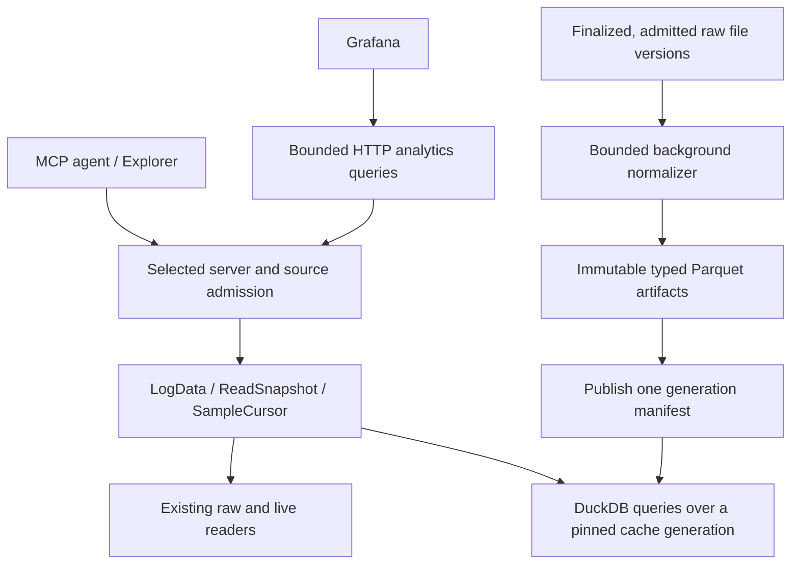

# Columnar Analytics Cache (DuckDB + Parquet) and Grafana Plan

Status: rejected on 2026-10-19. Nothing in it was implemented, and no other plan
depends on it. The reasons come first; the proposal follows unchanged under
[The proposal as submitted](#the-proposal-as-submitted), as the record of what was
considered and why it was turned down.

On 2026-10-21 the maintainer asked to revisit a columnar store for server installs only,
not students' laptops. [Revisited for server installs](#revisited-for-server-installs-2026-10-21)
records that review. The rejection stands until the maintainer decides on it.

## Why it was rejected

1. **It names no problem and sets no threshold.** The proposal says DuckDB and
   Parquet "may improve selective reads and cross-session analysis", but it cites
   no slow read, no question a team could not answer, and no budget exceeded, and
   [§8](#8-resource-bounds-and-performance-evidence) confirms there is "currently no
   measured performance claim". Phase 0 measures first and then decides whether the
   benefit "justifies the dependency and operational cost", with no number that
   would make the answer no. Reads are already lazy: logs are scanned from
   memory-mapped files, which is why the old disk cache of parsed logs is no longer
   read or written ([ARCHITECTURE.md](ARCHITECTURE.md#caching)). A second copy of
   the data needs a measured reason before it needs a design.

2. **Grafana does not need it.** The data endpoint already serves every sample of
   an entry, or buckets of minimum, maximum and mean reduced to a requested number
   of points, as Arrow or CSV ([STANDALONE.md](STANDALONE.md#the-data-endpoint)).
   The explorer plan made it the one door that "the viewer, an agent's script, and
   a dashboard" read ([EXPLORER_PLAN.md](EXPLORER_PLAN.md#1-decisions), decision 7).
   The pit server plan already schedules Grafana: Prometheus first, then a `json`
   format on that endpoint when someone needs full-resolution history, and it lists
   as an open question whether even that is worth building before the data browser
   ([PIT_SERVER_PLAN.md](pit-server/PIT_SERVER_PLAN.md#12-metrics-prometheus-and-grafana)).
   A new query route and a database engine are not the next step on that path.

3. **The cost comes first and the value last.** Phases 0 to 2 build a normalizer,
   generation publication and recovery, and adapters that feed DuckDB's rows back
   into the existing Java analysis, so until Phase 3 a tool's answers stay the same
   and any gain is speed that reason 1 has not shown is needed. Doing it safely
   takes a second implementation of the read contract, held equal to the first for
   as long as both exist: [§4](#4-lossless-values-and-query-projections) and
   [§6](#6-read-adapters-and-numerical-equivalence) list exact `int64`, nonfinite
   values and signed zero, struct and array shapes, schema damage, declaration
   conflicts, clock mappings and tie order, each checked against independent
   answers because agreement between the two backends proves nothing. And the
   session a team most wants to examine, the match that just ended, is the one
   least likely to have been normalized yet.

4. **It puts a native engine in the process that records the robot.** The pit
   server records NetworkTables in the same JVM that would host DuckDB. DuckDB's
   documented defaults use up to 80% of physical memory, spill up to 90% of the
   free disk, run one thread per core, and install known extensions from the
   network on demand, and its memory limit does not cover every native allocation,
   as [§8](#8-resource-bounds-and-performance-evidence) notes. Each setting can be
   pinned, but a native crash, a leak or a full disk would still be shared with
   capture, and a failed capture write stops recording for the rest of that robot
   boot ([pit-server/STANDALONE.md](pit-server/STANDALONE.md#sessions-and-capture-files)).
   The server has chosen against this before: the data endpoint lays out Arrow on
   the heap so that "nothing leaves the garbage collector's care"
   ([ARCHITECTURE.md](ARCHITECTURE.md#the-data-endpoint)), and the REV sync cache
   uses MessagePack because it "needs a compact file format and not a database"
   ([ARCHITECTURE.md](ARCHITECTURE.md#technologies)).

5. **Each publication snapshots the whole scope.** As drawn in
   [§3](#3-storage-and-consistent-publication), every generation holds its own
   scope-wide catalogs of sessions, source files, entries, projections, clocks and
   events, so one new session means a new snapshot of the scope: the work and the
   disk grow with the store, not with the change. The design follows the replica
   generation publication, which had to be split into bounded parts and still caps
   a catalog at a fixed number of files
   ([ARCHITECTURE.md](ARCHITECTURE.md#replica-generation-publication-owner)). A
   derived cache needs no generations. An entry named by the fingerprints of its
   inputs and carrying the format version that wrote it is written once, found by
   name, and ignored when either changes, which is how the REV sync cache already
   works ([`SyncDiskCache`](../src/main/java/org/triplehelix/wpilogmcp/cache/SyncDiskCache.java)).

6. **It would multiply the download.** The DuckDB JDBC driver, 1.5.6.0 at the time
   of writing, is an 85 MB JAR carrying native libraries for every platform, or 12
   to 33 MB built for one. The server's JAR is about 6.5 MB and the VS Code
   extension bundles it, so every install and update would grow several times over
   for a cache that is optional.

7. **It offers cross-session queries without cross-session statistics.** The
   server's guidance treats one log as one sample and names the confounders between
   matches: code version, battery, alliance partners and field position
   ([`AnalysisGuidance`](../src/main/java/org/triplehelix/wpilogmcp/tools/AnalysisGuidance.java)).
   The proposal says how to select and pin sessions, not what a number computed
   across them means: the unit of replication, data quality per session, and how a
   result reports what differed between the sessions it pooled. Pooling faster
   without those answers would only produce a misleading result sooner.

## What remains open

The review also found weaknesses in the current design that no cache would fix: an import can
stop a recording, nothing measures free disk space, and several costs grow with the whole
store. The [architecture hardening plan](ARCHITECTURE_HARDENING_PLAN.md) takes them in order,
including the first two questions below (its items 6 and 7).

- **Grafana.** Prometheus first, then the `json` format on the data endpoint when a
  team needs full-resolution history in a dashboard, as
  [PIT_SERVER_PLAN.md](pit-server/PIT_SERVER_PLAN.md#12-metrics-prometheus-and-grafana)
  plans. That step needs wall-clock time on the wire: the data endpoint returns the
  log's microseconds, and a time-series panel plots epoch time.
- **Questions across many sessions.** Start from the statistics: what such a result
  reports, its data quality per session, and how it names confounders. Then measure
  the raw reader on that workload. If scanning dominates, persist each file's scan
  index and summaries, keyed by content, before considering an engine.
- **Engines outside the server.** pandas, polars, DuckDB and R already read the data
  endpoint's Arrow streams without parsing. A team that wants SQL runs it on its own
  machine, where the cost is its own and no recording is at risk.

## Worth keeping

These rules from the proposal hold for any derived data the server adds:

- A cache miss or a bad artifact falls back only to the same admitted source, never
  to another copy that happens to match.
- A cursor never switches backends midway, and members that are not cached are
  never silently left out of an analysis.
- Derived data is keyed by the source bytes and every input that shapes it: decoder
  and format versions, schemas, the CAN database and the clock revision.
- Exact `int64`, nonfinite values and signed zero survive every representation, and
  a floating-point projection is labeled as one.
- Callers choose named queries and pass typed arguments; they never send SQL, paths
  or table names.

## Revisited for server installs (2026-10-21)

The maintainer asked to look again at a columnar store limited to server installs: machines
that run the standalone server as a service with a store, such as the pit server or a
separate analysis machine. The VS Code extension's bundled server and students' laptops are
out of scope. This section rereads each reason above under that scope. The maintainer
answered the [decisions](#decisions-for-the-revisit) at its end on 2026-10-21: both options are
measured first, and the rejection stands until then.

Since the list above was written, the wall-clock time it named as Grafana's prerequisite has
been implemented, unreleased, as `utc=true` on the data endpoint. Its Grafana item has become
[its own plan](GRAFANA_PLAN.md), which reads the endpoint's CSV and needs no new format.

### What it would be for

The [Grafana plan](GRAFANA_PLAN.md) plots one file per panel from the data endpoint and
needs no store of its own for that: a 1,000-point overview from a loaded log takes tens of
milliseconds. The open case is a panel across sessions, one entry from many files on one
wall-clock axis, such as a robot's battery across an event or a season. No route answers it.
On today's readers, one event's fifteen match logs took about 30 s on their first load, about
16 s after a restart with persisted scan indexes, and about 0.1 s while loaded. These figures
are rounded; they were measured locally on team logs and the exact results stay out of the
repository. A columnar store would answer such panels without opening the logs.

### The reasons, reread

1. **No problem, no threshold.** The problem now has a name, panels across sessions, and the
   measurement above. The threshold is now set; it is the third decision below.
2. **Grafana does not need it.** Still true for one file at a time. Not true across sessions,
   where no route exists.
3. **The cost comes first and the value last.** A server-only store can be smaller than the
   proposal: a derived view for Grafana alone. MCP tools, the read API and the Explorer keep
   reading WPILOG, so there are no adapters into analysis and no second implementation of the
   read contract to hold equal. Value arrives with the first converted session. What remains is
   showing that a converted file holds what its log holds.
4. **A native engine in the process that records.** Unchanged, and now a standing rule:
   [no native code runs in the process that records](ARCHITECTURE.md#no-native-code-runs-in-the-process-that-records).
   The engine must run in another process, best on another machine. A separate analysis
   machine fed by the mirror keeps both its memory and its disk away from capture. On the pit
   machine itself, the converter and the engine run as separate processes with their own
   memory limits, and write outside the store's filesystem or within capture's
   [disk reserve](ARCHITECTURE.md#capture-has-a-disk-reserve). The server's only added work is
   serving reads through its existing bounded workers.
5. **Each publication snapshots the whole scope.** Replaced by
   [derived data keyed by its inputs and its recipe](ARCHITECTURE.md#derived-data-is-keyed-by-its-inputs-and-its-recipe):
   one columnar file per finished WPILOG, named by the file's SHA-256, which its manifest
   already records, the converter's version and the clock mapping's recipe. Robot and session
   facts come from the catalog when a dashboard queries, not from scope-wide generations. A new
   session converts one file.
6. **It would multiply the download.** Gone under this scope. The engine ships with the
   Compose example on the server, never in the server's JAR or the extension.
7. **Cross-session queries without cross-session statistics.** Plots are views, but a number
   pooled across sessions on a dashboard would skip `compare_sessions`' per-session
   evidence and pooling rules. Provisioned dashboards plot each session's own series, and the
   Grafana plan's [rules for choosing files](GRAFANA_PLAN.md#across-sessions) and keeping
   overlapping recordings apart apply unchanged.

### A shape that fits

A converter runs as its own process, in a container beside Grafana. It finds finished
sessions in the catalog and reads each file's numeric entries through the data endpoint's
Arrow stream with `utc=true`. For each WPILOG it writes one Parquet file: entry, field, log
time and UTC in integer microseconds, the value, the sampling class and the unit. Integers
stay 64-bit integers, non-finite values and negative zero survive, and a value converted to
floating point is labeled as one. Rows without measured UTC are kept with an empty UTC and
counted. The entries converted are chosen by configured prefixes, as `metrics.include` chooses
topics.

Grafana queries the Parquet files through an engine in its own process or a service beside
it. Grafana's DuckDB data source, published by MotherDuck, runs DuckDB inside Grafana's
plugin process; it is unsigned, below version 1.0, and needs a glibc-based Grafana image.
Grafana Labs maintains a ClickHouse data source, but ClickHouse is a service with its own
memory and disk to operate. A time-series database fed by the same converter is a third
choice, with the most to operate. The server still accepts no SQL: dashboard SQL runs in
Grafana's engine, and Grafana's container mounts only the derived directory, read-only,
because that SQL can read anything its engine can reach.

Live data stays with Prometheus and the file-first path. The converter never writes the
store, and neither the tools nor the Explorer read the columnar files.

The converter's output for every fixture is compared value by value, timestamps included,
with the independent WPILOG reader. Time buckets computed in dashboard SQL are a presentation
with their own rule, not the server's bucket rule; panels whose numbers people quote say so
and link to the tools.

### Against the lighter option

The Grafana plan also proposes summaries kept by the server: for each file, minimum,
maximum, mean and count over short fixed intervals, keyed like the scan index, with no new
engine. They serve overview panels across sessions, and zooming in goes back to the file. A
columnar store adds queries of any shape over every sample of every session, at the cost of
an engine, a converter and their storage on a server. If the panels teams want are
overviews, the summaries are enough.

A third candidate lies between the two: [column files](COLUMN_CACHE_PLAN.md), proposed
on 2026-10-21 at the maintainer's request. Beside each log, the disk cache keeps its numeric
entries and struct fields as full-resolution columns, read by memory-mapping, with no engine and,
for now, no summaries. A prototype answered one entry across a synthetic season's 128 logs in
about 13 ms; it would be measured against the same targets.

### Decisions for the revisit

1. **A columnar store, or the summaries first.** The summaries answer an event-wide overview
   without a new engine; a columnar store also answers queries of any shape over every
   sample. Decided: measure both on a season-sized synthetic store before choosing.
2. **Where it runs.** On a separate analysis machine fed by the mirror, or on the pit
   machine in its own processes with memory and disk limits. The first keeps capture's memory
   and disk untouched. Decided: after the measurement.
3. **The target.** Decided: one entry across one event's matches in under 2 s after a
   restart, and across a season in under 10 s.
4. **The engine.** Grafana's DuckDB data source (no service to run, but unsigned and below
   1.0), ClickHouse (a service), or a time-series database. Decided: measure through DuckDB,
   and choose after seeing the numbers.

The rules under [Worth keeping](#worth-keeping) apply to any option chosen.

---

## The proposal as submitted

Status: proposed development plan; no columnar backend or performance result is
established by this document. The first implementation is an optional, rebuildable
analytics cache. Raw recordings and the existing store catalog remain authoritative.

DuckDB and Parquet may improve selective reads and cross-session analysis while
retaining ordinary `.wpilog` / `.revlog` directories, live capture, and existing
MCP and visualization behavior. Grafana should query the selected server over HTTP;
a laptop does not need its own recording files or local MCP server.

This plan follows the [design principles](ARCHITECTURE.md#design-principles),
[shared read contract](ARCHITECTURE.md#shared-read-api), and explicit source and
mirror decisions in [SOURCE_AND_MIRROR_PLAN.md](SOURCE_AND_MIRROR_PLAN.md). It does
not replace those contracts or declare the outstanding source/mirror gates complete.

## 1. Scope and coexistence

The initial scope is derived storage for finalized, admitted file versions. Active
recordings continue through the existing live reader and fixed-prefix contracts.
Normalization begins asynchronously after a member is finalized; capture does not
wait for it. Ordinary directory files remain usable without normalization.

The integration seams are [`LogData`](../src/main/java/org/triplehelix/wpilogmcp/log/LogData.java)
and [`LogAccess`](../src/main/java/org/triplehelix/wpilogmcp/read/LogAccess.java) /
[`ReadSnapshot`](../src/main/java/org/triplehelix/wpilogmcp/read/ReadSnapshot.java) /
[`SampleCursor`](../src/main/java/org/triplehelix/wpilogmcp/read/SampleCursor.java).
Each affected caller must be checked; these interfaces alone do not prove that
all tools, follow routes, or metadata operations can switch backends unchanged.



Cache selection happens after source admission. A cache miss, unsupported format,
or invalid artifact may fall back to the same admitted raw source within the
existing request budget. A refusal, revoked grant, changed generation, or missing
selected copy must not become a fallback to a different source. Do not switch
backends midway through a cursor or silently omit uncached members of an analysis.

The first checkpoints retain raw recordings in their current locations. Primary
catalog migration, raw-file deletion, normalized-artifact replication, arbitrary
SQL access, and live columnar ingestion require separate later designs. Existing
mirror ownership remains intact; cache eviction cannot remove authoritative or
replica payloads.

## 2. Authority, identity, and invalidation

A cache artifact is derived data, not a new authoritative recording. Its recipe
binds the exact source bytes and every interpretation input that affects its
contents:

- Source content SHA-256 and size, and the authoritative
  `(master_store_id, file_id, file_version)` when the source has that identity.
- Cache format and normalizer/decoder versions, recorded schema inputs, and REV
  DBC identity/version. Changes that alter decoding invalidate the derived data.
- Versions and parameters for any derived classifications, summaries, or events.
  Clock-dependent products also name their clock mapping revision.

Keep artifact identity separate from admission. Ordinary directory files do not
acquire invented master identities. Each request retains the selected server,
serving scope, source generation, and captured provenance. Equal hashes in two
stores do not authorize substituting one selected copy for another.

Carry the complete current verification and authority facts from
[`ReplicaReads`](../src/main/java/org/triplehelix/wpilogmcp/store/ReplicaReads.java),
including `legacy_unconfirmed`, `provisional`, `verified`, `master_local`, and
`authoritative_mismatch` where applicable. A later confirmation cannot retroactively
relabel an earlier answer. Cached bytes do not bypass path containment, current
grant checks, source identity checks, or the shared verified-hash admission owner.

A hash of a Parquet file detects changes to that artifact; it does not prove correct
normalization or master confirmation. Peer transfer of derived artifacts is deferred
until its recipe validation and trust rules are specified. The current replica
protocol is not implicitly extended to new file kinds by this plan.

## 3. Storage and consistent publication

Use immutable artifacts per source-file version or finalized recording member.
Sessions are manifests grouping those artifacts: a session can gain a rollover
member, late REV file, or revised placement without rewriting every existing sample.
Optional compaction produces new artifacts and a new generation.

The proposed layout belongs in a server-owned cache directory, outside raw source
and mirror directories. Exact placement is a Phase 0 decision; it must keep cache
objects out of source discovery, ingestion, and authoritative replica catalogs.

```text
<server-cache-root>/columnar/<scope-cache-key>/
  cache-state.duckdb                 # Optional rebuildable scheduling/index state
  current.json                      # Atomic pointer to one generation manifest
  generations/<generation-id>/
    manifest.json                   # Format, hashes, sizes, recipes, membership
    sessions.parquet                # Snapshot of admitted session metadata
    source_files.parquet            # Source identity and provenance snapshot
    entries.parquet                 # Original declarations and metadata
    projections.parquet             # Separate leaf-field query dictionary
    clocks.parquet                  # Clock proof and mapping revisions
    events.parquet                  # Versioned derived events, when supported
  artifacts/<artifact-key>/
    records.parquet                 # Record coordinates, state, diagnostics
    integers.parquet                # Exact int64 scalar/projection values
    floating.parquet                # Typed float/double values
    booleans.parquet
    text.parquet
    raw_bytes.parquet               # Encoded parents and opaque values as needed
    schemas.parquet                 # Original schema declarations and diagnostics
  staging/<job-id>/                  # Private, never queryable
  spill/<worker-id>/                 # Bounded temporary query/normalization files
```

This is a proposed decomposition, not a committed physical schema. Phase 0 chooses
row-group/part sizes and bounds for files, manifests, schemas, and projection
expansion. Large catalogs and source files must split into bounded immutable parts;
the manifest lists exact parts rather than relying on directory globs.

### Publication and recovery

A DuckDB transaction does not atomically publish a set of external Parquet files.
Use one generation publication point, following the existing
[replica publication ownership](ARCHITECTURE.md#replica-generation-publication-owner):

1. Reserve capacity for staging, output, replacement metadata, and deferred deletion.
   Read an admitted source snapshot under its normal lifetime protections.
2. Write private parts, close writers, flush the required files, verify sizes/hashes,
   and validate completeness and recipe identity. Recheck the source before admission
   to publication; changed sources invalidate the job.
3. Write immutable catalog parts and a manifest referencing only complete artifacts.
   Serialize the short final check and atomic `current.json` replacement with the
   cache publication owner. A cancelled, superseded, or revoked job cannot publish.
4. A reader pins one manifest and its referenced artifacts before querying. Catalogs,
   clocks, and samples come from that same generation; a live directory glob is not
   a snapshot. Admission rechecks still apply while the generation is pinned.
5. Retire superseded artifacts only after references are released. Pending deletions
   remain charged, including on Windows where open mappings can prevent removal.

A persistent DuckDB index, if used, is recoverable from published manifests and
source catalogs. Recovery treats a complete published generation as the cache
commit record, reconciles index divergence, and removes unreferenced staging only
after checking ownership. It never promotes unfinished output merely because it
exists after restart. Corrupt or unsupported cache generations are refused and
rebuilt from the admitted raw source; they cannot damage source metadata.

Specify and test atomic-replacement and flush behavior on supported filesystems.
Process-crash recovery is distinct from a physical power-loss guarantee. Disk space
is reclaimed after retirement, not necessarily immediately when a session disappears.

## 4. Lossless values and query projections

The cache must preserve the observable contracts of
[`Sample`](../src/main/java/org/triplehelix/wpilogmcp/read/Sample.java),
[`EntryInfo`](../src/main/java/org/triplehelix/wpilogmcp/log/EntryInfo.java), and
`ReadSnapshot`. Schema design starts with those contracts, not with a table of
floating-point values.

| Information | Required representation |
|---|---|
| Source and record identity | Source-file version/artifact key, declaration identity, original entry ordinal, raw timestamp in integer microseconds, record offset, and encoded payload byte count. Ordinals include malformed records. |
| Original entries | Original name, type, metadata, declaration history, and declaration conflicts. Keep these separate from generated field projections. |
| Numeric values | Exact signed `int64`, distinct boolean values, and the original float/double type. Preserve nonfinite values and signed zero according to the raw-reader contract; never replace malformed or absent values with zero. |
| Text and opaque values | Preserve strings, JSON/text content, opaque bytes, and decoder behavior for malformed inputs. |
| Compound values | Preserve parent record identity, array lengths and order, empty arrays, nested shape, nonnumeric fields, enum representation, and missing/invalid field state. |
| Schemas and damage | Retain original and transitive schemas, missing/invalid/conflicting schema diagnostics, decode problems, truncation boundaries, and damage information. |
| Summaries | Keep original record counts apart from decoded, finite, and per-projection counts. Record the basis of units, sampling classifications, and derived summaries. |

Do not encode every scalar as `DOUBLE`: `9,007,199,254,740,993` cannot be represented
exactly that way. Any transport that returns exact 64-bit integers must also use an
encoding that survives the client's number model; a Grafana floating-point projection
must be explicitly distinguished from an exact-value API.

For scalar tables, the conceptual row key is
`(artifact_key, declaration_id, ordinal)` with `raw_ts_us`, `record_offset`, and
`payload_bytes` retained. Leaf projections add a `field_path` and explicit value
state. Use separate typed columns/tables and validate the type discriminator; their
final DDL and schema-evolution rules are Phase 0 deliverables. An integer compact
join key alone is never a portable identity across caches or servers.

### Structs and arrays

[`FieldPath`](../src/main/java/org/triplehelix/wpilogmcp/read/FieldPath.java) can
produce additional typed leaf projections for selective queries. Those projections
do not replace the parent entry or its record count. Samples with an absent array
element retain their ordinal and gap semantics.

For whole-value reads, preserve enough typed parent structure to reconstruct the
shared decoder's values, or retain the original parent payload and decode it with
the recorded schemas. Initially, unsupported reconstruction uses the admitted raw
reader. Do not infer array shape from the leaves that happen to exist, or pivot
parents using only a name and timestamp: unrelated members can share both.

The first supported-type matrix must state exactly which requests can be served
entirely from Parquet and which need raw decoding. Complete compatibility is an
acceptance result, not an assumption about unchanged tool code.

## 5. Clock mappings and event coordinates

Store source timestamps unchanged. Reuse the proof and composition rules of
[`RecordedClocks`](../src/main/java/org/triplehelix/wpilogmcp/store/RecordedClocks.java),
[`SyncResult`](../src/main/java/org/triplehelix/wpilogmcp/sync/SyncResult.java), and
[`SessionSnapshot`](../src/main/java/org/triplehelix/wpilogmcp/read/catalog/SessionSnapshot.java).
A `.wpilog` suffix does not prove a zero offset to the selected session anchor.
Unproven relationships remain excluded with their explanation.

A mapping records source and anchor identity, offset in microseconds, drift and
its unit, reference timestamp, proof/basis, and revision. Conceptually, with drift
expressed as ppm:

```text
anchor_us = raw_ts_us + offset_us
            + rounded((raw_ts_us - reference_raw_us) * drift_ppm / 1_000_000)
elapsed_s = (anchor_us - session_origin_anchor_us) / 1_000_000
utc_us    = utc_anchor_epoch_us + (anchor_us - utc_anchor_time_us)
```

These formulas explain coordinates, not a replacement implementation. Integer
precision, rounding, overflow handling, chained transforms, and tie order must
match the existing mapping code. Reuse it first; a SQL expression must pass the
same boundary cases before replacing it. Source timestamps and mapping provenance
remain available in returned samples.

Real UTC is nullable when no supported wall-clock proof exists. Keep the actual
anchor coordinate and its epoch separately so robot uptime is not added twice.
If a Grafana view needs a synthetic display epoch, make it an explicit, labeled
option; it must not be returned as measured UTC or used to align sessions.

Manual alignment changes produce a new interpretation revision while raw sample
artifacts remain reusable. `set_revlog_offset` is not automatically converted into
a persistent write to master or mirror metadata. Preserve its current scope and
lifetime until a separate decision defines durable overrides. Any future local
override lives outside mirror-owned payloads and records its scope and basis.

Events retain source coordinates and supporting inputs, or an explicit dependency
on the clock revision that produced their intervals. A changed mapping must remap
or invalidate affected events in the same published generation as telemetry.
Do not retain stale elapsed/UTC event timestamps while shifting plotted samples.
Derived brownout, CAN, or loop annotations also name their rule version, parameters,
and evidence; logged events and calculated interpretations remain distinguishable.

## 6. Read adapters and numerical equivalence

Implement columnar cursors feeding existing Java analysis before adding SQL
aggregation. The initial adapter preserves the existing arithmetic and result
contract, including exclusions, `inputs`, true totals, diagnostics, and refusals.

| Existing seam | Initial columnar behavior and required check |
|---|---|
| `LogData.entries()` | Return original entries and metadata, not the generated leaf dictionary. |
| `sampleCount(entry)` | Use validated metadata for the original record-count basis, including malformed records where the current reader counts them. |
| `anyValue(entry, pred)` / `lastValue(entry, pred)` | Evaluate the Java predicate over compatible typed values in the required order. Translate only explicitly supported predicates whose semantics have been checked. |
| `values()` and whole structs | Materialize the Java objects required by the interface, or use the admitted raw fallback. Native execution does not remove this heap cost. |
| `SourceReduction` | Feed the existing bounded reducer through `SampleCursor` first. Preserve counts, finite handling, gaps, first/last values, bucket boundaries, and diagnostics. |
| `SessionCursor` | Preserve proven clock transforms, overlap policy, member order, source coordinates, and stable equal-timestamp ties. SQL joins/scans require explicit equivalent ordering. |
| `SyncDiskCache` | Retain it until columnar REV decoding has equivalent invalidation and fallback coverage. DBC/decoder changes must invalidate either representation. |

Later SQL pushdowns need independent expected answers and tests against the Java
path. `MIN`, `MAX`, and `AVG` are not a complete replacement for the existing
reducer. Parallel aggregation may also change floating-point accumulation order.
Exact identity, integer values, timestamps, counts, ordering, and diagnostics remain
exact; any permitted floating-point tolerance requires a documented per-operation
decision and independent error bound. Do not silently weaken existing assertions.

Parameterize the differential and conformance harnesses to exercise both backends.
Add sample-, metadata-, schema-, and failure-level comparisons as well as tool
results. The existing tests do not establish cross-backend equivalence merely by
passing unchanged, and agreement between two backends is not an independent oracle.

## 7. Query ownership, access, and Grafana

### HTTP first

The proposed `/analytics/v1/query` accepts named, server-owned query templates with
typed arguments: explicit source scope, session/file selection, entries/field paths,
time bounds, and result limits. The server controls SQL structure and file lists;
callers cannot supply SQL, filesystem paths, table names, or extension commands.
Values are bound parameters. Names and routes remain proposals until their schemas
and response contracts are implemented and documented.

Selection follows the same server/scope rules as existing tools. If several scopes
exist and the caller has not selected one, return choices and guidance to ask the
user. Never choose by availability or matching names. Cross-session analysis stays
within the explicitly selected scope; connecting to the pit server does not consult
the laptop's local MCP server.

Admission resolves the permitted source set, pins a generation, and rechecks grants
and source state on cached replies and subsequent pages. Query outputs name their
inputs, generation, clock basis, exclusions, and any truncation with true totals.
Pagination, retry, cancellation, and status envelopes must match the relevant
shared HTTP/MCP contracts before exposing the route over the LAN.

Prepared statements protect values when the server owns the SQL structure; they
do not make arbitrary caller SQL safe. External file access controls must explicitly
allow the required cache paths: `enable_external_access=false` alone also blocks
Parquet reads. No query may broaden its file list beyond admission. Pin and test
these controls against the chosen engine version. [DuckDB security documentation](https://www.duckdb.org/docs/current/operations_manual/securing_duckdb/overview).

### Engine and connection ownership

One owner manages cache publication and any persistent `cache-state.duckdb` writer.
Prototype query instances over pinned immutable Parquet separately from that mutable
index. Queries do not depend on opening the writer's database read-only from another
process. Connections to one DuckDB instance must use compatible startup options;
`SET access_mode='READ_ONLY'` on a mixed reader/writer pool is not an isolation
model. [DuckDB JDBC connection documentation](https://www.duckdb.org/docs/current/clients/java/connecting).

Phase 0 must prove the chosen instance/pool design, allowed-path configuration,
streaming JDBC behavior, cancellation, and cleanup before adopting a dependency.
An in-memory query instance is not by itself a sandbox. Keep SQL construction and
source admission in the server regardless of engine access mode.

### Grafana delivery

Start with HTTP through Grafana's Infinity/JSON data source. Its backend can send
query requests to the selected pit server; only bounded results travel to clients.
Test the time-series, table, null/large-integer, error, and annotation mappings.
[Infinity HTTP request documentation](https://grafana.com/docs/plugins/yesoreyeram-infinity-datasource/latest/advanced-features/url/).

Dashboard variables list only sessions in the selected scope. Annotation queries
use the same clock revision as plotted data. Initial dashboard candidates remain
Power & Battery, Swerve & Odometry, Loop Timing & CAN Health, and Mechanism Profiling;
their signal roles come from the existing resolver and explicit choices.

Direct local access through the DuckDB Grafana plugin or notebooks is a later
export feature. External readers cannot participate automatically in in-process
leases. Offer a pinned export with an explicit retention/release policy, or copies
owned by the consumer. Do not point them at mutable catalog files or live globs
and claim snapshot consistency. Test plugin/platform compatibility separately.

## 8. Resource bounds and performance evidence

Before integration, Phase 0 records concrete configurable limits, defaults, refusal
behavior, and owner/release points for every row below. No resource is implicitly
unbounded because work happens in native code or a background executor.

| Resource | Required ownership and accounting |
|---|---|
| Normalization | Bound server-wide and per-scope workers, queued/coalesced jobs, input scan bytes, projection expansion, row groups, and pending metadata. Capture and imports enqueue bounded work without waiting for normalization. |
| Query execution | Bound concurrent queries, engine threads across all instances, admission queues, scanned rows/bytes, and result rows. Exhaustion returns a documented retryable refusal. |
| Memory | Budget DuckDB native memory, JVM objects, JNI/driver buffers, decoded parents, manifests, and response encoding together. Record estimated accounting separately from measured heap/RSS. |
| Disk | Cap cache, staging, spill, exports, and retired-but-pinned artifacts; reserve peak replacement space. Low-space behavior keeps raw recordings and capture safe. |
| Time and cancellation | Define response and progress deadlines. A timed-out native call retains its worker and reservation until it unwinds; it cannot publish afterward. Test disconnect and shutdown paths. |
| Transport | Bound request bytes, identifiers, batches, encoded reply bytes, and slow-reader writes. Response reservations last through transport completion. |
| Lifetime | Bound open cursors, JDBC results/connections, pinned generations, and idle/absolute expiry. Release exactly once on success, refusal, exception, cancellation, removal, and shutdown. |

DuckDB's `memory_limit` covers its buffer manager, not every allocation in the
process. Native and Java costs must be measured together. [DuckDB limits](https://duckdb.org/docs/current/operations_manual/limits).

No parser, hash scan, native query, or callback runs under shared publication locks
or on the capture loop. Separate long normalization from short store notifications;
use daemon workers and bounded shutdown. If an in-process native operation cannot
meet the required containment/cancellation contract, resolve that in Phase 0 rather
than asserting a bound the engine cannot enforce.

Measure on the same machine against the current raw reader: cold and warm scalar
reads, struct-field and whole-struct reads, bounded plots, multi-session aggregates,
and concurrent capture/query workloads. Include ingestion time, cache size, bytes
read, JVM heap, process RSS, spill, cancellation latency, and capture interference.
Use synthetic fixtures of stated size and shape, including large arrays and many
small files. Distinguish application-cache state from OS-cache state.

Record commands, versions, counts, failures, timings, and machine details under
`build/reports/` as required by the [verification policy](DEVELOPMENT.md#verification-policy).
Commit concise conclusions with enough workload detail to reproduce them; repository
documentation must not depend on links to ignored local reports. There is currently
no measured performance claim, including for live reads or metadata lookups.

Pin the JDBC/native dependency and verify licenses, offline packaging, native library
loading, and the supported macOS/Linux/Windows architecture matrix. Missing support
must leave the raw backend usable with an explained cache-unavailable state. Native
platform tests and dependency installation are separate from this document update.

## 9. Checkpoints and acceptance gates

### Phase 0 — Contract, prototype, and baseline

- Finalize typed schemas, artifact recipe/versioning, supported-type/fallback matrix,
  clock mapping, generation manifest, cache location, and engine instance design.
- Select concrete resource budgets and prove JDBC streaming, allowed-path isolation,
  mixed workload behavior, cancellation, and native packaging for the pinned version.
- Record raw-reader baselines and prototype measurements. Decide whether the measured
  benefit justifies the dependency and operational cost before production integration.

Exit: reviewable contracts and measured evidence. Unresolved durable manual offsets,
primary catalog migration, and arbitrary SQL remain outside this checkpoint.

### Phase 1 — Optional derived artifacts and publication

- Build `ColumnarNormalizer` using the existing raw parsers and schema decoders for
  finalized admitted file versions. Keep raw sources and current store metadata.
- Implement bounded background admission, recipes, immutable parts, one generation
  commit point, retirement, corruption fallback, and format upgrades by rebuilding.
- Inject failures before/after each publication step; cover cancellation, changed
  inputs, disk exhaustion, restart, partial writes, and pinned-reader retirement.

Exit: the cache is optional and disposable; disabling or rolling it back preserves
raw reads and recording. Unsupported cache formats are rebuilt, not misinterpreted.

### Phase 2 — Read adapters and equivalence

- Add `DuckDbReadSnapshot` / `SampleCursor`, then the compatible `LogData` adapter,
  retaining existing Java analysis and explicit raw fallback for unsupported cases.
- Parameterize differential/conformance tests and check independent expected values.
  Include int64 extremes, nonfinite numbers, signed zero, duplicate timestamps,
  malformed/truncated records, declaration conflicts, nested/empty/changing arrays,
  schema errors, rollover, clock drift, unknown UTC, and manual alignment changes.
- Exercise selected-scope retention, revoked grants, mirror replacement, cached
  replies, session removal, saturation, slow readers, and bounded shutdown through
  real HTTP and MCP routes. Test cache/raw behavior without partial backend switching.

Exit: documented supported reads match the established contracts and fit measured
budgets. Fixes have failing-first regression tests; changed checks catch planted
regressions, following [DEVELOPMENT.md](DEVELOPMENT.md#testing).

### Phase 3 — Bounded analytics HTTP and Grafana

- Add named query templates, scoped session discovery, bounded results, pagination,
  and the documented HTTP/MCP envelopes. Extend tool schemas, registration, scenarios,
  guidance, and documentation when introducing cross-session MCP tools.
- Validate Grafana remotely against synthetic server data with no laptop recordings
  or local MCP dependency. Verify variables, annotations, clock labels, refusals,
  limits, and cancellation. Native editor/platform evidence remains separately named.
- Introduce SQL aggregation only where independent answers and measured gains justify
  it; preserve exact contracts or approve explicit numerical tolerances beforehand.

Exit: remote-only analytics works within explicit source selection and resource
limits, with reproducible evidence and all untested platforms/workloads disclosed.

### Later decisions

Primary metadata migration to DuckDB, raw-recording deletion, peer exchange of
normalized artifacts, durable alignment overrides, direct local exports, session
compaction, and live columnar ingestion each require their own scope and acceptance
criteria. This plan does not authorize them as incidental consequences of adding
an analytics cache.
