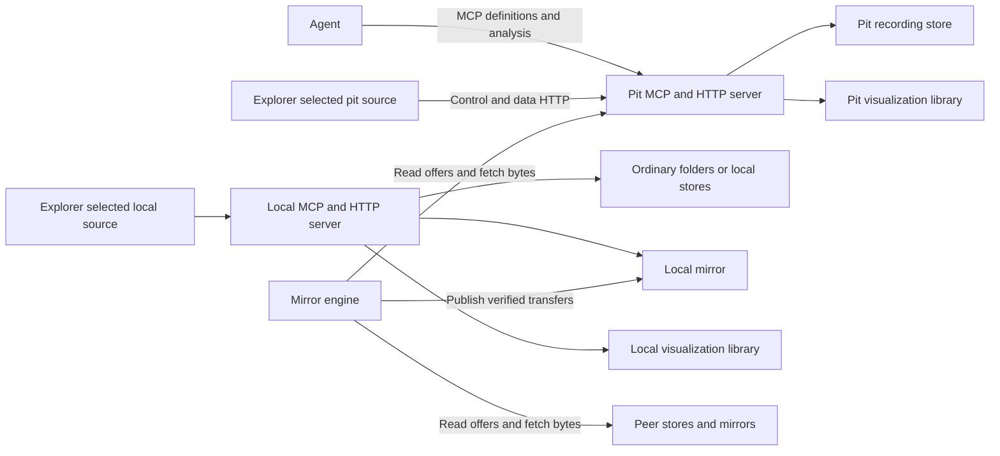

# Explorer sources and mirror implementation plan

Status: M1 source contracts, M2 server-library persistence and M3 direct connections are
implemented locally, 2026-10-19, and remain uncommitted. M3 verification and its remaining
limits are recorded below. M4 mirror identity/preservation is the next implementation checkpoint;
M4–M9 remain pending.

Explorer will connect directly to the server that owns the selected source. A laptop
can browse, analyze, follow and visualize remote recordings without a local MCP server
or local recording files. Optional mirrors provide separately selected local copies.
Only the mirror engine writes those copies; the master determines authoritative content.

This plan supersedes conflicting source routing, saved-definition storage and mirror
policies in [the visualization plan](VISUALIZATION_PLAN.md) and
[the pit server plan](pit-server/PIT_SERVER_PLAN.md). Their implementation records and
review evidence remain historical evidence. Current operational references continue to
describe the implementation until the checkpoints below change it.

## Agreed behavior

These decisions came from the owner interview. Protocol names, storage layouts and
initial engineering limits in subsequent sections are proposals for implementation.

| Area | Decision |
|---|---|
| Source browser | One Logs tree, with a separate root for each configured source. An unused collapsed source does not connect automatically. Views from separate sources can remain open together. |
| Remote operation | Metadata, analysis, data and live follows go directly to the selected owning server. Remote visualization needs no local server, mirror or laptop capture. Local visualization does not depend on the pit. |
| Source selection | There is no default store. With multiple configured choices and no explicit selection, the MCP service instructs the agent to ask the user. Availability, recency and matching filenames do not choose a store. An already explicit source or view remains selected for its operations. |
| Source kinds | Managed stores, mirrors and ordinary directory trees are separate sources. Browsing an unorganized directory does not require importing it or creating a store. |
| Manual and agent operations | Both use the same validation, binding, analysis, revisions and persistence services. Ordinary remote visualization covers reading, analysis, working views and permitted visualization metadata; log-library changes and administration are separate operations. |
| Saved definitions | Views and templates live in a library on the connected server, outside recording stores. They can be saved while reading a mirror or ordinary directory. |
| Mirror ownership | Ordinary import, capture, inbox and agent workflows do not write mirror contents. Peer admission, replacement and explicit cleanup all run through the mirror engine. Manually placed files are reported as unmanaged, not adopted as replica content. |
| Download scope | Users choose an explicit scope, optionally everything. Robot, event and date criteria select new downloads. Changing or aging out of that scope does not delete collected recordings. |
| Growing recordings | Copy each finalized file when available, including completed rollover members while the next member is growing. Active recording bytes are read from the explicitly selected remote source. |
| Master deletion | Retain local copies when the master deletes or stops listing them. |
| Capacity and cleanup | At the storage limit, preserve existing files and pause new downloads. Resume when space is available or the budget increases. Cleanup is explicit. No age-based or oldest-first eviction is implied. |
| Provisional recordings | Finalized peer files can be browsed, plotted and analyzed immediately, with provisional status visible in Explorer and MCP results. Master disagreement can replace provisional content after the correct copy is safely available. |
| Verified recordings | A verified file is never overwritten. A matching master confirmation changes metadata without rewriting correct bytes. A hash advertised by a peer alone is insufficient confirmation. |
| Conflicting peers | Keep the first accepted provisional candidate for a claimed file identity and version. Refuse later conflicting candidates and report the conflict. Filename equality alone does not establish that identity. |
| Peer discovery | Automatically discover peers for the same master store; also support manually configured addresses. |
| Peer redistribution | Share both verified and provisional finalized files, preserving provenance and status. Additional copies or transfer hops never promote provisional content. |
| Upstream submission | Mirrors do not submit recordings to the master. Unrecognized peer files can remain provisional until the master acquires them independently. |
| Agent display | Open in the originating eligible Explorer window when identified, otherwise the sole eligible window. Ask when several qualify; return an opening link when none does. Report display only after acknowledgement. |
| Copying layouts | Copy views/templates explicitly into the destination server's library. Adapting a view to a mirror requires an explicit destination source. Definition changes do not synchronize automatically. |
| Deferred decisions | Authentication mechanisms, accounts and detailed permission policy remain deferred. No account or personal-ownership guarantee is inferred from an MCP session. |

A mirror can retain files outside its download scope, retain files absent from the master,
and remain incomplete at capacity. Report retention, acquisition completeness and content
verification separately. None is a synonym for the other two.

## Planning baseline and required changes

Source anchors below describe `development` at `812c082fa9220ba5fd9b3f2f427fa1aee0502631`
plus the pre-M1 working tree inspected on 2026-10-18. M1 changes are recorded below; this table
preserves the planning baseline. The tree already includes the
consolidated review fixes recorded at the end of `VISUALIZATION_PLAN.md`; this plan does
not independently certify those fixes or their test reports.

| Current boundary | Evidence and change required |
|---|---|
| Preview client | [Explorer construction](../vscode-extension/src/explorer.ts#L96) supplies the local client to `RecordedPreview`. Replace the singleton lookup with a source-bound connection context. |
| Root discovery | [Logs tree expansion](../vscode-extension/src/explorer.ts#L729) fetches both local and pit listings. Build configured roots without opening unused connections; fetch each source on demand. |
| Remote overview | [`pitOverview`](../vscode-extension/src/explorer.ts#L565) consults the local listing; [preview opening](../vscode-extension/src/visualization/recordedPreview.ts#L237) translates a pit URI to a laptop file. Remote overview must use the selected remote server directly. |
| Legacy fallback | [Legacy editor loading](../vscode-extension/src/explorer.ts#L1105) can switch a failed pit read to `offlineCopy`. Replace this with an explicit action that opens a separately bound local view. |
| Agent connection | [`registerPitClaude`](../vscode-extension/src/extension.ts#L544) prepares the standalone installation and may start the local server for a credential bridge. Remote-only agent setup must not depend on that daemon or installation path. Credential-provider design remains separate. |
| Transport admission | [`CallerContext`](../src/main/java/org/triplehelix/wpilogmcp/mcp/CallerContext.java), [`VisualizationEndpoint`](../src/main/java/org/triplehelix/wpilogmcp/mcp/VisualizationEndpoint.java#L55), [`VisualizationTools`](../src/main/java/org/triplehelix/wpilogmcp/tools/VisualizationTools.java#L55) and workspace methods require local authority. Introduce operation-specific remote visualization admission without changing local-only administration globally. |
| Saved definitions | [`VisualizationWorkspace.destination`](../src/main/java/org/triplehelix/wpilogmcp/visualization/VisualizationWorkspace.java#L197) and [`save`](../src/main/java/org/triplehelix/wpilogmcp/visualization/VisualizationWorkspace.java#L323) select a writable store. `VisualizationMetadata` and `TemplateMetadata` persist through `LogStore`. Move this ownership to the server library. |
| Persistent server identity | [`ServerIdentity`](../src/main/java/org/triplehelix/wpilogmcp/visualization/ServerIdentity.java) already supplies a UUID and separate state directory. Reuse them; distinguish persistent identity from a process epoch and from a connection address. |
| Content and location | [`StoreReadCatalog.resolveContent`](../src/main/java/org/triplehelix/wpilogmcp/read/catalog/StoreReadCatalog.java#L239) searches stores sharing an origin; recording resolution requires exactly one such store. Qualify both operations with the selected serving scope. |
| Existing source schema | [`contracts-v1.json`](../src/main/resources/visualization/contracts-v1.json) has recorded origin/hash, unmanaged locator and anchored session forms. Preserve their evidence, but add an explicit serving owner and scope through a versioned contract. |
| Mirror retention | [`MirrorSync.run`](../src/main/java/org/triplehelix/wpilogmcp/store/MirrorSync.java#L94) and `choose` perform scope/cap eviction. `copyable` excludes the master's own captures. Retain collected files and admit all eligible finalized recording members, including captures. |
| Transfer versus authority | [`StoreManifest`](../src/main/java/org/triplehelix/wpilogmcp/store/StoreManifest.java) and the transfer journal carry `verified` facts. Introduce separate authoritative confirmation; do not reinterpret a successful peer transfer as master verification. |
| Peer exclusions | [`StoreSync`](../src/main/java/org/triplehelix/wpilogmcp/store/StoreSync.java#L83) refuses mirrors as target and source. Add a mirror-specific offer/admission path; ordinary union sync must still not become a mirror writer. |
| Mutation and I/O | [`LogStore.mirror`](../src/main/java/org/triplehelix/wpilogmcp/store/LogStore.java#L675) runs `MirrorSync` inside `mutate`, under the store queue and cross-process lock. Separate network transfer and hashing from short publication turns. Complete futures outside the lock. |
| Existing placement | [`MirrorSync.Local.verified`](../src/main/java/org/triplehelix/wpilogmcp/store/MirrorSync.java#L573) uses staged files, a pending journal and move reservations. Preserve the recovery intent while making verified objects immutable and publication generation-aware. |

The 2026-10-17 consolidated path's mandatory laptop capture, exclusion of finalized pit
captures, and prohibition on remote visualization are superseded requirements. Existing
captures, mirrors, clock records and independent recording services must survive migration.
Do not revive the earlier laptop-server relay as the implementation of direct access.

## Owners and data transport



MCP carries bounded source descriptions, analysis results, view definitions and display
requests. The server performs reductions and numerical analysis. Explorer obtains bounded
sample pages, Arrow streams and ordinal follow data directly from that same server through
the existing read and visualization services. Bulk telemetry need not pass through the
agent's conversation. Static `render_chart` images remain a separate existing workflow.

Return data descriptors with a server identity, relative route, negotiated format and
session-bound read handle where needed. Resolve them against the selected configured
connection. A returned URL or view definition cannot silently introduce another server.
Validate a descriptor's owner before following it. Connection addresses and credentials
belong to client configuration, never portable view/template definitions.

The extension host owns sockets, bounded decoding and webview delivery. The webview renders
data and interactions; it does not infer units, resolve signal roles or duplicate analysis.
Local transient display buffers and configuration are compatible with remote-only use;
downloading recording files or launching a local daemon is not a prerequisite.

## Source identity and explicit selection

### Separate the identities

| Identity | Lifetime and purpose |
|---|---|
| Configured connection | Client-local endpoint and credential-provider settings. A mutable locator, not durable data identity. |
| `server_instance_id` | Existing persistent UUID of the named server. Bind saved views, libraries and configured connection verification to it. |
| Server epoch | New process/session generation. Invalidates request handles, cursors and stale asynchronous completions after restart. |
| `scope_id` | One selected serving store or configured directory root. Use the store's own UUID for a store, including a mirror's own UUID. Derive ordinary directory scope UUIDs from their canonical configured root, without creating stores; a moved directory receives a new scope. |
| Master store identity | The authority for replica content. It is separate from the mirror's serving scope and server. |
| File identity and version | Stable logical member UUID plus immutable version UUID, assigned by the master or explicitly claimed by a provisional offer. A path or timestamp does not supply this identity. |
| Content hash | Exact bytes of an admitted finalized version. Equal hashes do not merge sources or establish all identity/provenance claims. |
| Recording identity | Existing provenance-backed recording identity and anchored member relationships. Session aliases nominate members; they do not prove membership by themselves. |

Introduce source-reference schema 2 alongside schema 1. M1 wraps the existing recorded, session
and unmanaged forms; the following logical file-version content is reserved for M4 and is not
accepted by M1. A future catalog file example is:

```json
{
  "schema_version": 2,
  "server_instance_id": "11111111-1111-4111-8111-111111111111",
  "scope_id": "22222222-2222-4222-8222-222222222222",
  "content": {
    "kind": "file_version",
    "master_store_id": "33333333-3333-4333-8333-333333333333",
    "file_id": "44444444-4444-4444-8444-444444444444",
    "file_version": "55555555-5555-4555-8555-555555555555"
  }
}
```

Other `content` variants retain the current recorded origin/hash form for legacy files,
the anchored recording form, or an unmanaged opaque locator ID. All are restricted to the
outer serving scope. Directory paths remain in the owning server's private locator registry.
Revoking a directory grant makes its source unavailable; it does not widen the search.

Each admitted read also returns the actual hash or live prefix, content generation,
verification basis and server epoch. These are immutable facts about that result. A logical
provisional file reference can survive authoritative correction, but a completed result's
hash and basis never change retroactively. Explicitly hash-pinned legacy reads remain pinned.

A master disagreement about an already verified file identity/version is an authority
conflict. Keep the verified bytes and refuse replacement. Legitimate new bytes require an
explicit new version, which can coexist with the old one. A master restart, epoch reset,
new URL, filename change or later modification time does not authorize overwrite.

### Enforce selection at both boundaries

The server's `SourceScopes` service enumerates configured stores and directory
scopes under existing grants. Session-owned directory leases are shared across clients; this
checkpoint preserves that model and does not introduce private per-session directories. `StoreDoor` remains the store-specific adapter. Scope discovery and
file discovery are distinct operations: listing choices is permitted before selecting data.

For an unqualified data request with multiple configured, caller-visible scopes, return the
existing result-contract status `error`, code `SOURCE_SELECTION_REQUIRED`, bounded choices and a
hint instructing the agent to ask the user. Include unavailable configured choices;
availability does not turn one candidate into a default. A single configured scope may be
selected without ambiguity. Do not infer scope from the sole matching log after a search.

An explicit source reference, source-qualified file selection or already bound view is a
choice, so follow-up requests do not ask again. Apply the rule through shared read admission
and the log-tool base, including exceptional tools that open multiple inputs themselves.
Existing explicit multi-log analysis retains separately identified inputs; this project
does not add automatic cross-server federation or change its numerical algorithms.

The client's connection registry applies the same choice rule across configured servers.
Each server can enumerate only its own scopes; do not pretend a pit daemon knows the
laptop's entire connection configuration. Agent-host registration and guidance must expose
the named connection choices without requiring a laptop MCP daemon. Test this separately
from the per-server enforcement. Persisting a preferred import destination must never select
a source for reading.

### Bind the entire view to one owner

Create an immutable connection context per open overview/view: connection identity,
confirmed server UUID, selected scope, session, epoch and cancellation generation. Pass it
to inventory, details, bindings, statistics, charts, raw reads, follows, health, save and
control delivery. Cache keys include owner, scope, source and admitted content generation.
Remove global active-client lookups from asynchronous view work.

Changing a root selection does not retarget existing views. Revocation, restart or endpoint
replacement cancels old work and revalidates the same owner before resuming. Late responses
cannot populate another source's page. A different server at the same address is an identity
change, not a successful reconnect. Opening a mirror copy is an explicit new binding.

Build roots from configured descriptors and cached labels. Connection setup can enumerate
available scopes explicitly. Expanding a root connects only to its owner; a disconnected
root displays that condition. Collapsing an unused root releases its browsing work. Active
views and separately configured mirror jobs retain their own lifetimes. Merely configuring
a remote source does not enable mirroring or local NT capture.

## Visualization library and display

### Separate persistent library

Add a `VisualizationLibrary` beneath the existing server visualization state directory,
with saved views, templates, revision receipts and legacy aliases in its own namespace.
It uses a dedicated bounded queue and cross-process lock. It does not call a log-store
mutation queue, create a store or enable ingestion. An ephemeral server reports that durable
save is unavailable; it does not silently substitute a laptop library.

Reuse strict configuration validation, canonical template digests, optimistic revisions
and idempotency receipts. Preserve the existing prepare-library-commit-working-checkpoint
ordering: reserve intent on the working-state queue, release it, commit the library record,
then complete the working checkpoint. Recovery can finish a committed save after a crash.
No owner waits on another queue while holding its lock, and callbacks run after release.

Proposed initial library bounds: 1 MiB per configuration, 4 MiB per persistent record including
bounded receipts, 1,024 live objects and 64 MiB aggregate accounted metadata; at most 64
receipts per object. Before mutation, check that the public object fits the negotiated
encoded reply budget, including MCP escaping and envelope overhead; the configuration
limit is an upper bound, not a promise that every 1 MiB string fits every transport. List
in pages of at most 256 rows and within that reply budget. Quarantined
library files count toward storage admission; an oversized pre-existing library opens for
inspection without silently deleting records. Working-view quotas retain their existing
independent limits. These are implementation bounds to test, not measured heap claims.

Use library references containing server/library identity, object UUID and revision. Save
requires no recording `store_id`. Saving a view of a mirror therefore does not modify that
mirror. Updating a source grant still affects subsequent reads of the saved definition.

Explicit cross-server copy exports a bounded definition envelope through the client and
imports it through the destination library with a new object identity and retained provenance.
It requires no server-to-server fetch of an agent-supplied URL. A view copy
also requires the destination source choice. Compatibility and signal binding run there;
identical names or an unavailable old source never select a replacement. Templates retain
their declared requirements. The original definition and later edits remain independent.

### Remote route policy

Implement a visualization operation policy shared by HTTP and MCP. Separate source reads,
working/library metadata operations, and administration. Replace the applicable local-only
checks with that policy; do not relabel a network caller as `HTTP_LOCAL` or weaken
`CallerContext.requireLocal()` for unrelated operations.

Origin checking, path containment, grant revalidation, strict parsing, session isolation,
request limits and transport completion accounting remain required. Directory registration,
credential bridges, capture controls, mirror cleanup and log-library mutation retain their
separate admission rules. Authentication providers and user-level sharing policy are outside
this plan; existing configured deployment access remains the starting point. A session is
an ephemeral capability owner, not proof of a person's identity.

Introduce `/visualizations/v2` for qualified sources and the library contract, with the same
named-operation MCP tools accepting negotiated `api_version: 2`. Keep v1's strict schema
and exposure policy intact during migration. Do not silently accept extra v2 fields in v1.
Negotiate capabilities again after an epoch change. An older server that lacks direct remote
visualization reports that limitation; it never triggers an automatic local-server fallback.
Legacy callers still pass through shared source selection, so an ambiguous request receives
an explicit refusal even when its older schema cannot express the new qualification.

### Display handshake

Retain the planned `visualization_client_list`, `visualization_explorer_open` and
`visualization_open_request_get` operations. Creation, display request and acknowledged
opening remain distinct results. Establish an originating-window association through a
registered session capability, never a guessed active window or an arbitrary caller label.

Filter eligible windows by selected owner, source accessibility and required capabilities.
Use an identified eligible origin first, otherwise the sole eligible window. Multiple
candidates return `AMBIGUOUS_CLIENT`; none returns an opening URI containing stable IDs
and no arbitrary network address or credentials. An explicitly selected missing window
does not fall back to another. Opening a link resolves configured connections and asks
for configuration if its owner is unknown; it never silently adds a server.

Use the existing control-notification owner for delivery. Open requests have idempotency
IDs, a 60-second expiry and bounded receipts. Acknowledgements name request, view, revision,
window and epoch. Lost acknowledgement means display is unconfirmed; retries cannot open
duplicate documents. Restart/session replacement expires the old registration and requires
resynchronization. Continue to expose opaque window IDs, never another session's bearer ID.

## Mirror protocol and verification

### Offers and authority records

Add a versioned, paged replica protocol beside the ordinary store door. Keep ordinary peer
union import separate. The master and peers expose finalized file offers and immutable byte
reads; the mirror engine pulls them. There is no general upload-to-mirror endpoint and no
automatic upstream submission operation.

An offer contains protocol version, serving peer identity, claimed master identity,
claimed file/version, recording/member relationships, size, SHA-256, completion basis,
provenance and the serving peer's verification claim. A recipient checks transfer integrity,
format, containment and scope before publication. An unchanged size/mtime is not proof of
finalization. Managed writers supply final manifests; imported files need the importer's
completed-version record. A peer's final manifest and immutable size/hash are sufficient
claims for provisional admission, with that basis retained. Master confirmation is not a
prerequisite for provisional use; only the master can confirm authoritative finalization.
An offer for a known growing member must be refused.

The master issues a catalog record binding its store, file identity/version, size, hash and
finalization facts to a catalog epoch/revision. A mirror records how and when it obtained
that record directly from its configured master. A cached matching authoritative record
can verify peer-supplied bytes while the master is offline. A peer's assertion that it was
verified, or a relayed receipt whose authority the recipient has not established, remains
a claim. Cryptographic delegation and authentication of these records are deferred with
authentication; they must not be simulated by trusting a peer's boolean flag.

Only the master can make a claimed file identity authoritative. New peer files lacking a
matching master record remain provisional, even if the master independently acquires other
similarly named files. Exact mapping requires the matching identity/version or an explicit
master-issued alias; correlation or a basename is insufficient. A directory-tree source
does not become a peer supplier merely because Explorer can browse it.

Store format 2 adds file identities/versions and replica state that old readers must not
ignore. New readers retain format-1 compatibility; format-2 writers require explicit
migration. Old binaries must refuse format 2. Do not add provisional fields to format 1
where an old binary could serve them as authoritative or resume automatic eviction.

### Per-file state

Keep transfer integrity, authoritative verification and conflicts as separate fields.
The peer conflict flag does not undo existing verification or pick a winner.

| Current state and event | Required transition |
|---|---|
| No local file; finalized offer accepted | Reserve capacity; stage into a private temporary object. It is neither listed nor shared until the full offered bytes and format validate. |
| Valid first peer candidate, no established master record | Publish `provisional`, preserving the claimed identity, observed hash and provenance. |
| Same claimed version and same hash from another peer | Reuse existing bytes. Record bounded additional provenance without rewriting the payload. |
| Same claimed version and different peer hash | Keep the first accepted candidate, refuse the incoming candidate and record a bounded conflict. Arrival order is not a correctness claim. |
| Master confirms the current hash | Persist the confirmation and promote to `verified`; do not rewrite bytes. |
| Master contradicts provisional hash | Mark authoritative mismatch; stage and verify the correct content before changing the published generation. Keep the old generation available until safe publication. |
| Replacement cannot fit or cannot complete | Retain the original with explicit mismatch/replacement-pending status. Do not delete it to make room. |
| Master contradicts verified hash for the same version | Keep verified content and report an authority conflict. A new declared version is a separate object. |
| Master no longer lists a file | Keep the local object and its historical verification basis. Do not turn catalog absence into deletion or an overwrite instruction. |
| Hash/format failure, incomplete transfer or cancelled job | Do not publish. Retain a bounded resumable staging record or discard only the unpublished partial; existing published files are unaffected. |

First-candidate admission is atomic under the store publication owner. Two concurrent
downloads cannot both win. Verified content takes precedence over a provisional candidate
when the master record is already established. Identical hashes for different logical
files can share immutable storage only if separate identity/provenance records remain intact.

Every data result and Arrow metadata identifies its admitted bytes and replica basis.
Analysis on provisional bytes is allowed; it cannot receive an unqualified verified label.
When the master has disproved the candidate, report that stronger fact. A provisional
replacement invalidates affected inventories, bindings, cached reductions and follows.
Explorer discloses the change and refreshes against the same selected scope and logical
source. Already returned statistics retain their original hash and basis; no result is
retroactively relabelled or silently combined with the replacement.

Clock records, placement facts and member/schema relationships carry their own evidence.
Verifying payload bytes does not verify unrelated peer metadata. Continue using shared
clock, schema and member-identity services; a name or conflicting declaration cannot decide
compatibility. An analysis using provisional clock facts reports that basis even when its
recording payload is verified.

If read admission detects corruption of locally held verified bytes, fail the read and
report corruption. Historical confirmation does not certify the corrupted current bytes.
Repair requires a separately staged generation matching the already established hash;
it never overwrites bytes in place or changes the authority's immutable version definition.

### Publication and crash recovery

Use immutable payload generations plus an atomic manifest reference to the current
generation. Preserve original filenames in provenance and readable storage names. Finalized
verified payloads are not overwritten in place. Reuse `StoreFiles` containment and atomic
operations and `LogFileAccess` leases/reservations; extend the shared read admission to pin
the actual generation, not merely a pathname that can change beneath it.

1. Reserve the file identity, policy revision, destination generation and capacity in a
   durable intent on the owning store queue. Release the queue/lock before network I/O.
2. Stream bounded chunks into staging. Checkpoint only flushed bytes, with a resume identity
   tied to the exact offered version, size and hash. Revalidate partial bytes after restart.
3. Verify full size/hash and required format outside the store lock while retaining the
   reservation. A timed-out worker still owns its charges until it actually unwinds.
4. On the publication queue, recheck job generation, policy, master evidence, destination
   identity and capacity. A cancelled or superseded job cannot publish. If another operation
   already confirmed the incumbent, the provisional replacement intent is no longer valid.
5. Force the new object and journal, publish the manifest reference atomically, then record
   completion. Release ownership and notify readers outside the store lock.
6. Retire a replaced provisional generation after admitted readers release it. Removing that
   obsolete generation is completion of the authorized replacement, not retention eviction.

Recovery must be idempotent at every boundary: journal before payload, payload before manifest,
manifest before completion receipt, and completion before old-generation removal. If safe
reader retirement cannot be obtained promptly, defer cleanup and keep charging those bytes.
An admitted old read finishes against its pinned generation or returns an explicit source
change; it never combines generations. Process shutdown stops admission, cancels transport
and waits only within a bound. A surviving I/O operation retains its resources and cannot
publish after shutdown or policy replacement.

## Scope capacity cleanup and peer discovery

### Collection and capacity

Replace retention selection with an acquisition predicate. Preserve existing robot/event/date
facts and their stated basis; an unknown date stays visible as unknown and does not acquire
a guessed timestamp or match a date predicate without evidence. An all-recordings scope
still includes it. Define filter semantics in the configuration schema: robot selection
is conjunctive with the selected event/date expression; offer an explicit all-recordings
scope. A filter decides new admissions, never whether a held file survives.

All finalized captures within scope become eligible, including rollover members from a
still-open recording. Report both local member coverage and the master's recording state;
holding every currently finalized member does not mean the growing recording is complete.
Do not copy a master's entire session manifest and imply that missing members are local.

Closed clock records and finalized companion files travel with their verified identities
and relationships. The current continuously growing system-text transfer must not silently
weaken the completed-recordings decision: retain already held text prefixes, and design
future text-version admission as explicitly identified immutable prefixes. Do not turn on
continuous active-recording replication as a side effect of this migration.

Charge published payloads, retained old/provisional generations, partial files, outstanding
reservations and bounded mirror metadata against the configured budget. Concurrent admission
uses checked arithmetic and a single reservation owner. Replacement must fit alongside the
old generation; promotion of identical bytes needs only bounded metadata space. Report
accounted logical bytes separately from filesystem free space and measured disk allocation.

At capacity, expose `capacity_paused` with held, reserved, provisional and missing counts,
and the first refusal reason. Reads, confirmations and status remain available. Reserve
bounded metadata and recovery headroom before admitting payloads, so confirmations and
explicit cleanup remain possible at payload capacity. Never claim complete synchronization
from a truncated offer page or an unreachable master. A fresh
complete catalog revision supplies the denominator; while offline, report completeness
against the last known revision and its age.

### Explicit cleanup

Add preview and execute operations owned by the mirror engine. The preview names exact
file versions, hashes, bytes, affected views, provisional/verified status and whether the
master is currently known to hold them. Execution binds that preview to a policy/catalog
revision and idempotency ID. Reject a stale selection rather than deleting a changed file.
Active-reader retirement follows the same rules as replacement. Unmanaged files are never
cleanup targets. Files placed manually in a mirror are reported separately, never served
as replica content and never adopted or removed automatically. This is application write
ownership, not a promise to prevent unrelated operating-system writes.

Proposed engineering default: explicit removal also writes a local acquisition exclusion
for that exact file/version, so the next pass cannot immediately undo cleanup. Show this in
the preview and provide explicit re-inclusion. A new version is a distinct acquisition
candidate. Exclusion metadata and receipts are bounded and persistent; never forget an
exclusion silently under pressure. Payload exhaustion must not consume the reserved cleanup
headroom. If the bounded metadata reserve itself cannot hold a new exclusion, refuse that
cleanup before deleting its payload and explain how to increase the budget.

### Finding and serving peers

Use a server-owned discovery adapter, independent of Explorer windows and their root
expansion. Target DNS-SD service discovery over local-link mDNS, with manual HTTP(S)
endpoints using the same handshake. DNS-SD supplies service instances and endpoint records;
mDNS supplies local-link discovery. The protocol basis is [RFC 6763](https://www.rfc-editor.org/rfc/rfc6763)
and [RFC 6762](https://www.rfc-editor.org/rfc/rfc6762). Adapter/provider selection requires
a dependency and native-platform evaluation in checkpoint M7; no provider is installed by
this plan. Use a project service type and versioned bounded TXT fields, with the exact type
and registration disposition fixed in that checkpoint before interoperability claims.

Advertisements are endpoint hints. Fetch the bounded protocol handshake, match master
store identity and negotiated capabilities, then enumerate offers. Never treat the service
name or peer verification claim as authority. Advertising an unrelated store does not add
it to Explorer's configured sources. Advertise only an intentionally network-serving
endpoint; manual endpoints cover networks where discovery is unavailable.

Do not follow arbitrary redirects, forward a master's credentials to peers, or turn an
advertised URL into an unrestricted fetcher. Connection policy remains separate from
content verification. Keep caches of candidate peers bounded, deduplicate by stable peer
identity, expire addresses, back off failures and limit concurrent probes. Store/session
renames and address changes do not change file identity. Redistribute only fully published
objects, with original provenance and bounded transfer history; do not share staging files.

Choosing a supplier for an already selected mirror file is a transfer decision. It never
chooses another Explorer source or changes the configured master.

Use a protocol-versioned offer page and immutable byte endpoint, tentatively
`/replicas/v1/catalog` and `/replicas/v1/files/<file-id>/<version>` qualified by serving
scope and candidate hash. A catalog cursor binds a fixed revision, filters and peer session;
expiry restarts reconciliation without resetting completed local admissions. Requests for
already held identity/hash pairs produce no transfer, preventing loops among mirrors.

## Resource ownership and initial bounds

The following are proposed caps to implement and measure. They do not promise total JVM
heap, operating-system buffers or sustained throughput. Retain existing stricter limits
where a shared transport applies.

| Resource | Proposed owner and bound |
|---|---|
| Replica transfers | Two active jobs server-wide, at most one per destination mirror. No queue of payload jobs; each configured mirror has one coalesced request to retry fairly. |
| Transfer buffering | Reuse the transfer engine's 64 KiB step. Reserve at most 1 MiB of application transfer buffers per active job, including prefetch; metadata/control use separate bounded pools. |
| Verification workers | Share the two transfer slots through full verification and publication preparation. Timeout does not free a slot held by an OS read. |
| Peer discovery | At most 64 candidate peers, two simultaneous handshakes, 4 KiB TXT metadata per candidate and 64 KiB handshake replies. TTL and failure expiry release candidates. |
| Replica catalog pages | At most 256 offers and 1 MiB encoded per page; byte-shortened pages must advance and report true totals when known. No unbounded season catalog in a response or reconciliation map. |
| Replica catalog handles | Eight server-wide, two per client, 32 MiB accounted metadata per handle and 64 MiB aggregate; 60-second idle and five-minute absolute expiry. Charge builds and retired in-flight readers too. |
| JSON controls | 64 KiB ordinary control requests and 1 MiB encoded replies. Existing larger configuration/import operations keep their separately bounded envelopes; do not truncate valid definitions to fit an unrelated request class. |
| Inventory and follow operations | Preserve the current recording inventory, selected-detail, follow and decoded-window budgets. New scopes do not multiply a window's allowance. |
| Library | Bounds in the library section; parsing, encoded output and in-flight object copies must be accounted separately from durable byte quotas. |
| Mirror disk | Configured storage cap includes all engine-owned held/staged/retired bytes and reservations. A bounded metadata allowance is reserved within it before downloading. External filesystem consumption can still cause I/O failure; handle it without deleting existing payloads. |
| Status and history | Bounded per-file conflict/transfer receipts plus compact counters. Peer gossip cannot append an unlimited provenance chain. |

Reuse shared HTTP/MCP admission and response reservations through encoding and the final
socket write. Preserve the dedicated recording-inventory limits and prove that new replica
traffic also has a bounded request owner and reserved control capacity. Health, ping and
close must remain usable while transfer or data readers stall. Deadlines cover request
bodies, bounded drains, remote reads and response writes; distinguish a response deadline
from actual task termination. All builds and parsers check limits before large allocations.

Remote discovery, listing, downloads, hash reads and completion callbacks stay outside
shared state locks. Publication and policy mutation are short serialized store operations;
they recheck the generation captured before I/O. Health/status are published snapshots.
Recording must not wait behind mirror transfers or a visualization-library save. Instrument
reservation acquisition/release, catalog scans, file opens, hash bytes and retained mappings.

## Migration and compatibility

1. **Preserve the working baseline.** Integrate existing review fixes and other Stage 3 work
   separately. Keep historical evidence. Changes in this plan do not certify old native or
   performance gates or authorize commits, publication or production-store migration.
2. **Connections and scopes.** Import existing local and pit settings as named configured
   connections with no default. Preserve stored credentials through provider references.
   Existing directory grants remain scoped to their original server. Do not eagerly start
   the local server while registering or expanding a remote source.
3. **Source references.** Wrap legacy references only when their owning server and serving
   scope can be established uniquely. Several stores containing the same origin/hash require
   user selection. Persist migration receipts; unavailable or ambiguous legacy references
   remain recoverable and unresolved. Never rewrite them to a convenient mirror.
4. **Definitions.** Copy valid store-backed views/templates into the server library through
   an idempotent migration, verify canonical content and revisions, and record old-reference
   aliases. Retain originals. Conflicting IDs remain distinct or explicitly unresolved;
   no silent last-writer choice. Retain oversized legacy definitions as unresolved and
   exportable; never truncate them to satisfy a new reply budget. Update working checkpoints
   after the library commit.
5. **Mirror policy.** Pause legacy automatic retention before starting the new engine.
   Upgrade explicitly to format 2 with preservation semantics. Retain all old files, old
   capture copies, pins, provenance, clock records and partial journals. Convert pins to
   explicit acquisition inclusions without letting them override the new storage cap.
6. **Verification migration.** Reuse a historical master receipt only where its exact
   identity/hash relationship is established and bytes still validate. A legacy `verified`
   boolean alone is not proof of master authority. Otherwise retain the file with a legacy
   unconfirmed basis pending reconciliation; never delete it to simplify migration.
7. **Rollback and restart.** Journal upgrades and publish the new format marker only when
   durable state is coherent. Old binaries refuse the upgraded writable format. Keep a
   readable backup and recovery instructions; do not implement downgrade by deleting new
   metadata or relabelling provisional files. A refused startup leaves all data intact.

Existing local captures remain separate sources and keep their explicit runtime settings.
Changing Explorer's selected source neither starts nor stops capture or synchronization.
Preserve the shared clock and member-identity services; do not rebuild them inside adapters.

## Implementation checkpoints

Each checkpoint produces a reviewable code change, failing-first regression evidence,
appropriate mutation checks and updated owning documentation. Dependencies prevent a
partially migrated client from silently choosing a source or changing retention behavior.

| Checkpoint | Work and principal files | Acceptance before proceeding |
|---|---|---|
| M1 Source contracts and selection — complete, uncommitted | Add `SourceScopes` and schema-2 source validation; qualify `StoreReadCatalog`, `RecordedSources`, shared read admission and MCP guidance. Adapt `LogRequiringTool` and exceptional multi-input routes. Preserve `VerifiedContentHashes` ownership. | Two stores with the same origin/hash stay distinct. Multiple choices refuse unqualified data requests. Explicit choices survive reorder, rename and unavailable neighbors. Legacy ambiguity is reported. No numerical changes. |
| M2 Server visualization library | Add `VisualizationLibrary`; adapt `VisualizationWorkspace`, `VisualizationMetadata`, `TemplateMetadata`, native save references and strict tool schemas. Add idempotent legacy migration. | Save against a mirror and an ordinary folder with no writable log store. Crash/retry cannot duplicate saves or advance the wrong working revision. Originals survive migration. Quotas include receipts and in-flight work. |
| M3 Direct connections and remote visualization | Add a shared extension connection registry/context; replace local assumptions in `explorer.ts`, `recordedPreview.ts`, `recordedClient.ts`, `dataClient.ts`, follow/health adapters and agent registration. Add shared operation admission in HTTP/MCP. | Remote-only GUI and agent workflows work with the laptop daemon stopped and zero local recordings; local-only works with the pit unavailable. Inactive roots make no calls. Simultaneous views never cross owners. Legacy offline fallback becomes explicit. |
| M4 Mirror identity and preservation | Introduce format-2 file/version and replica records, master catalog receipts, acquisition-only scope, strict capacity reservation and explicit cleanup/exclusions. Adapt `StoreManifest`, `MirrorSync`, `MirrorService`, configuration and mirror routes. | Master deletions, clock advance, narrowed scope and capacity pressure delete nothing automatically. Closed captures/rollover members are eligible. Active bytes are excluded. Old mirrors migrate without lost files or false verification. |
| M5 Transfer and publication ownership | Split `LogStore.mirror` into short state turns and bounded I/O workers; implement immutable generations, resumable staging, journals and read-lease retirement. | Cancellation, every injected crash boundary, full disk, blocked reads and shutdown preserve the incumbent. Verified objects never get overwritten. Timed-out work remains charged and cannot later publish. |
| M6 Peer offers and reconciliation | Add the paged replica protocol to server and client adapters. Permit mirror supply through this protocol, with provisional claims, first-candidate conflict handling and master reconciliation. | Three synthetic servers propagate provisional data without promoting it; identical transfers deduplicate, conflicting candidates are refused, master correction changes only provisional content, and there is no upstream submission. |
| M7 Discovery and configuration UX | Add discovery adapter/provider, manual endpoints and bounded handshake inventory; generalize single-mirror runtime ownership if needed for multiple configured mirrors. Fix service wire fields and evaluate dependency/platform behavior. | Discovery loss, address changes, duplicate announcements and foreign masters cannot retarget a mirror. Manual endpoints work without discovery. Disposing a window does not stop server-owned synchronization. Native platforms prove provider support. |
| M8 Agent display and explicit definition copy | Complete the planned client/open-request tools and notification handshake; provide source-bound links and copy-to-library workflows. | Origin/sole/multiple/no-window cases, lost acknowledgements, retries, restart and expired requests behave exactly as specified. A copied view requires a destination source and retains original provenance. |
| M9 Integrated acceptance and migration rehearsal | Run the matrix below, original Stage 3 gates and documentation/schema checks. Rehearse upgrade from preserved format-1 stores in scratch fixtures. | Review records distinguish automated, native, platform, crash and measured resource evidence. No uncompleted performance or shop gate is reported as passed. |

M1 precedes source-dependent work. M2 and M3 establish remote-only visualization before
mirror development is required. M4 and M5 must be integrated before enabling the new mirror
writer; a policy-only halfway state must not feed the old eviction/publication engine.
M6 precedes automatic discovery. M8 depends on M1–M3 and can be delivered independently of
peer synchronization. These are logical dependencies, not instructions to run concurrent
Gradle processes or to delegate implementation.

## Acceptance and regression evidence

Use only synthetic recordings/stores for this plan's implementation fixtures. Run one
Gradle process at a time. Retain independent oracles for values, expected file/member sets,
ordering, hashes and provenance. A successful request alone is not a correctness check.

| Scenario | Required observations |
|---|---|
| Remote-only laptop | Stop the local MCP daemon; use an empty local log directory. Browse, filter, inspect, plot, zoom, read statistics/raw data, follow, save/reopen and accept an agent-created view through the remote server. Assert no local daemon start, local log read, capture or mirror request. |
| Independent local operation | Make the pit unreachable. Local stores, mirror reads, ordinary folders and the local definition library remain usable. No remote retries are required by those views. |
| Multiple sources | Remote master, its local mirror and another directory contain overlapping names and hashes. Exercise explicit selection and requests lacking it through HTTP, MCP and Explorer. Assert exact owner/scope on every operation and cache. |
| Lifecycle and scope | Hide/reveal, filtering, expiry, session removal, restart, grant revocation, renamed files, endpoint reuse and delayed responses cannot switch source, revive a disposed owner or lose a valid selection. |
| Enumeration and data | Traverse independent 5,000-, 10,000- and 20,000-topic recordings with rollover, declaration conflicts, Unicode and exact-type filters. Compare complete sets/counts/order and numeric results; include zero matches and byte-shortened pages. |
| Saved definitions | Ordinary folders and mirrors need no writable recording store. Verify CAS, idempotency, restart, failed saves, migration collisions, missing source, explicit copy and unavailable library behavior through both adapters. |
| Provisional exchange | A supplies B, then B supplies C while the master is offline. Status never strengthens through gossip. A cached direct master receipt can confirm matching bytes. Conflicting offers keep the first accepted candidate, including a concurrent race. |
| Master reconciliation | Confirm identical bytes without rewriting; replace mismatching provisional bytes only after full verification. Refuse changed bytes for an already verified identity/version. New versions coexist. Missing master entries leave copies intact. |
| Scope and capacity | Advance the clock, shrink filters, remove master entries, fill the cap and exhaust physical disk. Published files survive. Reservations include concurrent/staged/retired bytes. Cleanup previews are revision-bound and exclusions prevent immediate redownload. |
| Interrupted publication | Crash before/after flush, journal, payload move, manifest commit and receipt. Restart repeatedly. Open readers observe one generation; no partial or timed-out job becomes current. Inject failures in metadata writes, hashing, rename and cleanup. |
| Transport pressure | Stall HTTP and MCP readers together, incomplete request bodies and peer downloads. Test malformed/oversized bodies and IDs, denied Origins, mixed batches and notifications. Health/ping/close remain usable; reservations last through socket completion. |
| Resource accounting | Count actual opens, hash bytes, catalog scans, staged bytes and retained mappings at service seams. Pages do not repeatedly reopen prefixes or rehash; fresh detail reads still revalidate through the shared verified-hash owner. Report measured heap separately. |
| Discovery and identity | Simulate duplicate peers, stale addresses, master identity changes, announcement floods and loss of discovery. Native macOS/Linux/Windows tests cover the chosen provider and interface behavior. No advertisement chooses a new master. |
| Agent display | Exercise associated window, sole eligible window, multiple candidates and none. Test stale registration, explicit missing destination, duplicated notification and lost acknowledgement. The agent never confuses created with displayed. |

Each regression plant names the changed contract, expected failing test and restored hash.
Compilation, dependency/setup or infrastructure failures are not caught-regression evidence.
Run destructive plants only in an isolated scratch checkout and retain the original tree.

At a completed implementation checkpoint, use the applicable targeted checks first, then
the end-of-round checks from [DEVELOPMENT.md](DEVELOPMENT.md#verification-policy). The
integrated gate uses an actual fresh test execution:

```sh
./gradlew cleanTest build license followBrokerTest --console=plain
```

Then in `vscode-extension`:

```sh
PATH=/opt/homebrew/bin:$PATH /opt/homebrew/bin/npm test
```

Record actual commands, start/end times, counts, skips, platform and limitations. Native
VS Code checks cover the oldest supported and current version where pure logic tests
cannot reach the behavior; arrange interactive editor runs with the owner. The 32-lease
declaration burst, season-sized catalog scans, sustained throughput and native Linux/Windows
work remain distinct gates; this plan makes no
performance or production-readiness claim.

## Documentation ownership and remaining engineering decisions

Keep implemented behavior in `doc/STANDALONE.md`, `doc/TOOLS.md`, `doc/OPERATIONS.md`, both
architecture guides and the extension README synchronized with each checkpoint. Update
tool registration, descriptions, scenarios, capabilities and conformance limits together.
Keep this document as the decision/dependency record and link checkpoint evidence from
`VISUALIZATION_PLAN.md` and `pit-server/PIT_SERVER_PLAN.md`.

The following require evidence during implementation, rather than another product-policy
interview: discovery provider and wire registration, persisted format-2 DTOs and upgrade
transactions, OS-specific durable publication behavior, exact scope-filter schema, and
measured adequacy of the proposed budgets. Pin each in its owning checkpoint before enabling
the dependent feature. Authentication and detailed permissions remain deliberately deferred;
they are not claimed solved by session IDs, discovery or hashes.

The initial planning pass changed documentation only. Its source-anchor, link, JSON-example and
preservation checks are recorded in
`/private/tmp/wpilog-visualization-stage3-review-13/source-mirror-plan/verification.json`.
Runtime suites, native editor runs and implementation acceptance gates were not run for this
initial pass; all checkpoints were pending at that point. The following M1 record supersedes
that implementation status.

## M1 source contracts and selection checkpoint

M1 is implemented locally. No commit, version change, installation or publication was made.
The pre-existing implementation, notes and reviews were preserved. Evidence is in
`/private/tmp/wpilog-source-mirror-m1/validation.md`, with the baseline snapshot, task-only patch,
commands, XML results, mutation details and final preservation hashes beside it.

The server now enumerates bounded source choices with `list_source_scopes`, and unqualified
log discovery asks the agent to obtain a user choice when multiple scopes exist. Missing
configured roots still count. Imports do not supply a read default. A chosen store, mirror or
directory is kept separate; a matching origin/hash on a neighbor never supplies a fallback.
`StoreReadCatalog`, `ManagedLogAccess`, `RecordedSources` and recording access guards share those
rules. Existing absolute server-local paths remain explicit file selections, including separate
inputs to multi-log analyses. Scoped relative paths and move aliases must stay in the selected
scope. No numerical algorithm changed.

Visualization API 2 wraps the strict legacy content reference with server identity and serving
scope. HTTP and MCP use the same admission and analysis owners. API 1 rejects qualified
references and operations on qualified views before mutations. Qualified unmanaged locators and
views survive restart on the same durable server. Cached inventory pages recheck selected access;
fresh details reuse the shared verified-hash owner. The hash owner itself was unchanged.

Engineering choices fixed in M1:

- Store scopes use the store's own UUID, including mirrors. Directory UUIDs derive from canonical
  configured roots; they survive reorder/restart, while moving an ordinary directory changes its
  scope. Configured symlink roots resolve consistently, retaining directory team/origin metadata.
- Scope discovery includes nested stores as separate choices and refreshes discovery before
  selection. A new store must not remain temporarily blended into its former directory scope.
  Descriptor output is bounded (1,024 scopes, 64 rows and 64 KiB raw JSON per page). Scoped reads
  and listings now discover once per request, retain the selected identity and recheck configuration,
  store identity and path ancestry without another tree walk; recording pages use the same bounded
  checks. The 2026-10-19 macOS probe (five warm-ups, twenty calls, one 100-sample WPILOG, 100 unrelated
  folders) reduced scoped means from 32.229 to 7.952 ms with 2,000 text files and from 207.337 to
  55.954 ms with 20,000. This is a local warm-cache measurement, not a throughput,
  season-scale or heap claim. Future discovery caching needs explicit invalidation tests.
- Existing directory leases are shared across clients and owned by sessions. This checkpoint adds
  no private-directory or authentication model. Both visualization API versions remain local-only.
- Schema 2 currently supports recorded, anchored session and unmanaged content. Logical immutable
  file versions belong to M4. The server library and source-aware Explorer are M2 and M3.

Validation used synthetic fixtures on macOS arm64, Java 21.0.9. The final clean Java gate passed
4,252 tests with 85 skipped (4,337 cases); license checks and all four real-server broker tests
passed. Earlier whole-suite runs encountered a bind collision in an unchanged fake-daemon test;
the clean rerun and final gate passed, with all attempts retained. Nine isolated regression plants
failed their named executed tests and were restored with matching source hashes. Compilation and
setup failures were excluded from that count. The extension suite passed 852 tests with four skipped (856 cases); those four run in the
broker task. All 25 final documentation/schema/guidance checks passed. Command timings are in
the validation record.

This checkpoint is not the remote-only Explorer feature: the existing preview remains an API 1
client, and the old multi-source listing cannot bypass the new server choice requirement. M2 is
next: server-owned visualization library persistence. M3 supplies explicit Explorer roots and
direct remote transport. No native VS Code UI, Linux/Windows run, robot/store operation, mirror
transfer, large-catalog scan measurement or sustained throughput gate was performed for M1.

### Independent M1 review corrections

The independent review in `/private/tmp/wpilog-source-mirror-m1-review/review.md` reproduced two
admission/discovery defects. Both are corrected locally; the original review and its evidence
remain unchanged. The correction evidence is in
`/private/tmp/wpilog-source-mirror-m1-fixes/validation.md`.

- Raw `/read/v1/follows` creation rejects a qualified source or a top-level `scope_id` before
  admitting a lease. Previously it discarded the server/scope envelope and could read the local
  master, or refuse an explicitly selected mirror as ambiguous. Qualified follows use an API 2
  working view's binding, which retains the selected mirror and rechecks its availability even
  on a cached retry. Legacy unqualified follows still work.
- Store discovery catches I/O failures per configured root and retains the failed root in its
  inventory, including cached replies. Source selection reports it as unavailable, preserves
  known store identities, and allows explicit listings and reads from healthy roots. Previously
  a directory permission failure aborted all scope enumeration with an internal error. Failed
  roots still count toward ambiguity; they cannot make a healthy neighbor the default.

Nine new regression cases cover the refusals, legacy and qualified-view controls, exact sample
values and member paths, revoked-scope cached retries, healthy listings/reads, cold discovery,
store identity retention and permission recovery. Before the fixes, eight cases failed and the
qualified-view control passed. Three setup errors in the first attempt were corrected and
excluded from regression evidence. The related suites passed 114 cases. Four isolated mutation
plants failed their named checks, were restored byte-for-byte, and all nine scratch cases passed
after restoration. Permission tests use synthetic POSIX directories and restore permissions in
finally blocks; platforms without POSIX permissions or with permission bypass skip those cases.

The correction gate passed `cleanTest build license followBrokerTest`: 4,261 Java tests passed,
85 skipped (4,346 cases), license checks green, and all four real-server broker tests passed
without a broker rerun. The extension suite passed 852 tests with four skipped. The first full
gate caught a documentation-check failure that treated a newly backticked field name as a tool;
the manual now links to the view-follow instructions and the clean gate was repeated successfully.
The original logs are retained. No new native editor, Linux/Windows, production or performance
validation was performed, and the later checkpoints remain pending. Nothing was staged or committed.


### M2 implementation and local verification

The server visualization library now owns API 2 saved views, templates, revision/import receipts
and legacy aliases below its existing state directory. API 1 remains the legacy store-backed
compatibility surface. The native editor uses API 2 for library and working-view operations;
source inspection and transport routing retain their existing local connection until M3.
First save asks for a library title, without granting a directory or invoking ingestion.

The working intent is persisted before library work and completed only after the library commit.
Opening a library view publishes its working checkpoint atomically. Migration copies one pinned
store definition, namespaces its ID by store, verifies canonical content and revision, and retains
original files. Explicit API 2 Save of an existing legacy working view performs that migration
before its current configuration is saved. Migration never guesses a source scope. Library views
retain private ordinary-file locators independently of draft expiry; source access is rechecked
on opening and reading. Legacy definitions outside the reply budget remain unresolved and locally
inspectable/exportable.

Bounds are 1,024 objects, 64 MiB accounted persistent metadata, 4 MiB per record and 64 combined
receipts per object. Admission charges the complete temporary replacement alongside the original,
including retained unknown/quarantined files. The disk queue has eight pending slots; four admitted
operations and an 8 MiB serialized-input reservation pool also bound in-flight work and completion
callbacks. Callbacks run off the disk queue after the cross-process lock is released. Library
requests share the existing four HTTP/MCP data workers and 8 MiB response reservation pool; control
traffic remains usable. Lists keep at most 257 candidate summaries and return at most 256 rows
within the 1 MiB encoded reply budget. They reflect current metadata rather than a fixed snapshot.
These are accounting limits, not measured heap or throughput claims.

Evidence is retained in `/private/tmp/wpilog-source-mirror-m2/validation.md`, with the complete
check ledger, patches, hashes and mutation records beside it. The initial three Java regressions
and two native-client regressions failed against the old implementation for the expected
behavior. Later failing-first checks covered exact fractional revisions, unreadable-row counts,
checkpoint recovery and save retries after uncertain outcomes. Compilation/setup failures are
excluded from regression evidence.

Initial M2 local gates: `./gradlew cleanTest build license followBrokerTest --console=plain` passed
4,293 Java cases with 85 skipped (4,378 total), license checks and four real-server broker cases.
The extension suite passed 857 cases with four skipped; those four run under `followBrokerTest`.
Thirty-four deliberate plants were caught in an isolated copy and restored with matching hashes.
The complete suite also exposed missing conformance registration for the new tools; all three now
have schema-generated refusal cases and an isolated migration/list/open success workflow.

Verification corrected a pre-existing real-server test weakness: filename sorting selected
0.9.1 ahead of 0.10.0-dev5 when both JARs existed. The fixture now selects the exact current
package version and asserts the running version. Its old combined-directory expectation now
checks M1's selection-required refusal and explicitly selects the leased directory. The final
extension result uses the current artifact; earlier stale-artifact passes are not final evidence.

Final boundary checks also cover paging past retained malformed long filenames and preflighting
the larger portable-template export reply before publication. A template that fits its ordinary
reply but exceeds the export envelope is refused before any library mutation.

The working baseline was copied before edits; all 58 prior M1 hashes and 32 notes/reviews matched.
Existing unrelated work, notes, HEAD and the empty index are preserved. The native fixture now
checks library saves without creating a recording store, but VS Code 1.101/1.141 runs have not
been launched pending approval to open test windows. Native Linux/Windows, actual power-loss
faults, measured heap usage and sustained throughput remain unverified. Direct remote Explorer
routing is M3; no remote server, robot or production store was used here.

### M2 save-recovery review correction

The independent review reproduced a lost save response whose completed revision-4 receipt
replaced an acknowledged revision-5 editor state. The server retained revision 5, leaving the
next edit to fail with `REVISION_CONFLICT`. Recovery now retries the original UUID and reads the
current working view and checkpoint before returning it to the controller. A failed read keeps
that intent for another retry. The controller preserves a newer accepted notification and
re-emits edits outside the recovered checkpoint after native Save acknowledges its clean
position. An already reconciled notification cannot conflict with deferred local gestures.
Newer edits remain dirty; the next Save checkpoints them with a new UUID.

Evidence: `/private/tmp/wpilog-source-mirror-m2-save-recovery/validation.md`. The review's real
HTTP sequence failed before the fix and passed afterward using the current dev5 JAR and compiled
client/controller, including a successful subsequent edit and save. Six new regressions cover
current-state reconciliation, native dirty events and Undo/Redo, read failures, unchanged-state
recovery, deferred gestures and notification ordering. Five additional mutations were caught
in an isolated copy and restored with matching hashes. Setup failures are excluded.

The clean Java/build/license/broker gate passed 4,293 Java tests with 85 skipped and all four
broker tests. The extension suite passed 863 tests with four broker-only skips. All 44 incoming
M2 implementation hashes and 32 notes matched before this correction. Unrelated work and notes
remain unchanged; nothing was staged, committed or published. These tests drive the native
controller headlessly; native VS Code and Linux/Windows checks remain outstanding, as do the
later remote-routing and performance checkpoints.


## M3 checkpoint: direct connections and remote visualization (2026-10-19)

The Explorer and VS Code MCP provider now share lazy named connection contexts. Logs exposes
collapsed connection roots and source scopes; commands with multiple choices ask, and never
choose by availability. Remote-only configuration starts no laptop server and needs no local
recordings. The compatibility null setting preserves local plus optional `pitServerUrl` choices;
mirror and local live acquisition now require explicit enablement. Local-only browsing remains
independent of an unavailable pit.

Each source context pins persistent server UUID, confirms a process epoch on reconnect and
retains its scope. Replacing configuration retires existing contexts; late replies cannot retarget
views. Source/view documents carry configured identities rather than arbitrary network endpoints.
The native source URI encoding preserves Unicode and reserved characters across VS Code URI
serialization. Tabs identify their connection. The old automatic pit-to-mirror/capture translation
is removed: another copy is an explicit new document. The ordinary Explorer retains the chosen
remote catalog's Follow control, and notebook URLs and agent prompts retain owner/scope.

API 2 permits direct remote source reads, working views and server-library operations under one
HTTP/MCP admission policy. API 1 remains local compatibility; administrative routes and legacy
migration remain local. Origin checks remain enforced. Qualified references survive inventory,
charts, history, cursor/statistics/raw reads, view follows and data/cache identity. Data replies
recheck source admission, including 304 responses. A cached closed writer index can now serve a
finalized file without eviction; an active prefix still requires the recording route. Existing
local view bindings omitting a version remain compatible; remote bindings explicitly use API 2.

The native provider retains one owner per document, with a shared decoded budget and analysis
queue across connection children. Reconnects restore the same owner/view; the M2 lost-save
reconciliation fix remains in place. Native remote registration for Claude uses HTTP and never
starts a local bridge; no actual user registration was changed during verification. Credentials
remain origin-scoped and are not placed in CLI arguments.

Evidence is in `/private/tmp/wpilog-source-mirror-m3/validation.md`: clean Java/build/license,
real-server and extension counts, both native editor versions, failing-first corrections,
scratch-only plants, exact final hashes/patches and preservation checks. The final gate passed
4,299 Java tests with 85 skipped, all five real-server broker tests and 876 extension tests with
five broker-only skips. VS Code 1.101.0 and 1.141.0 each passed five native workflow groups
against two synthetic remote owners, with zero laptop-daemon starts. Twelve distinct regression
plants produced behavioral assertion failures in an isolated copy and were restored; setup and
compilation failures are excluded. All 32 prior notes/reviews remain byte-identical, and HEAD and
the empty index are unchanged. This checkpoint makes no throughput or measured-heap claim.
Physical remote-network/proxy deployments, native Linux
and Windows, actual agent UI registration/conversations, and the full earlier native live-panel
stress matrix were not exercised here. The original declaration-burst, season-sized catalog and
sustained-throughput gates remain pending. Mirror identity, peer offers, transfer publication,
discovery and agent display handoff remain M4–M9 work. No robot or production store was used.
